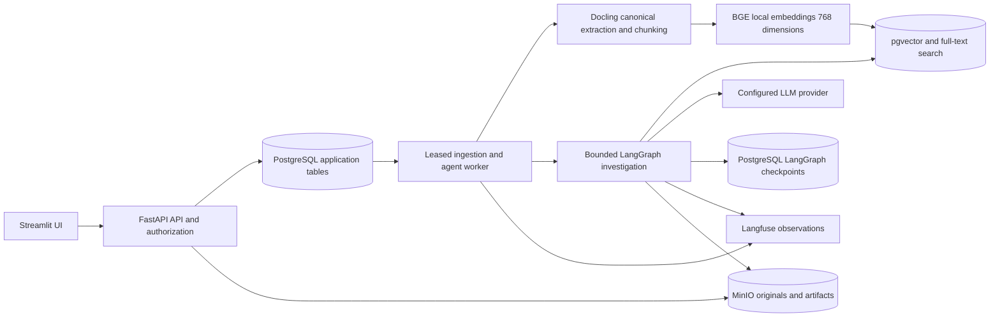

# Document Intelligence and Investigation Assistant

A working local prototype for the Document Intelligence assignment, using Streamlit, LangGraph, Docling, PostgreSQL/pgvector, MinIO and self-hosted Langfuse. It ingests documents, retrieves authorized evidence, answers multi-step questions, compares revisions and reports conflict candidates with citations and human review.

This submission uses a representative synthetic corpus. It does not claim tested capacity for one million documents. Mocked components, incomplete features and evaluation failures are stated below.

See the [current models, Langfuse usefulness, capabilities and evaluation status](docs/current-system-and-evaluation-status.md) for the latest local test snapshot.

## Setup

Requires Docker Desktop, Python 3.12 and [uv](https://docs.astral.sh/uv/). From the repository root:

```bash
uv sync --frozen
uv run python -m scripts.configure_local
```

The configuration command creates missing local secrets in `.env` and preserves existing values. A fresh setup copies `.env.example`, whose default provider is **LM Studio**:

```dotenv
LLM_PROVIDER=openai_compatible
LLM_MODEL=qwen/qwen3.5-9b
LLM_REASONING_EFFORT=none
OPENAI_BASE_URL=http://host.docker.internal:1234/v1
OPENAI_API_KEY=lm-studio
```

Start LM Studio's OpenAI-compatible server on port 1234 and load the exact configured model, or select Groq in `.env`:

```dotenv
LLM_PROVIDER=groq
LLM_MODEL=openai/gpt-oss-120b
LLM_REASONING_EFFORT=medium
GROQ_API_KEY=your-private-key
```

Then start the application:

```bash
docker compose up -d --build
```

| Service | Address |
|---|---|
| Streamlit workspace | http://127.0.0.1:8501 |
| Interactive API documentation | http://127.0.0.1:8000/docs |
| OpenAPI JSON | http://127.0.0.1:8000/openapi.json |
| Health | http://127.0.0.1:8000/health |
| Langfuse | http://localhost:3000 |
| MinIO console | http://127.0.0.1:59001 |

Langfuse admin credentials are generated in `.env` (`LANGFUSE_ADMIN_EMAIL` / `LANGFUSE_ADMIN_PASSWORD`). Local identity keys and local infrastructure defaults in `.env.example` are for this loopback-only demonstration. Real SSO is mocked. See [provider configuration](docs/llm-providers.md) for native URLs and the optional host Codex gateway; a personal Codex login is not required for the default setup.

Docling and BGE may download public model weights on first use. Prefetch Docling models before a scan/OCR demonstration:

```bash
docker compose exec worker docling-tools models download layout tableformer rapidocr
```

Named Docker volumes persist data and model downloads. After changing `.env`, recreate app services with `docker compose up -d --no-build api worker ui`. `docker compose down` stops services without deleting volumes; volume deletion is deliberately not part of submission cleanup.

## Demonstration dataset

Five original three-page PDFs are included in `output/pdf/financial-ui-tests/`. They cover old/new financial policies, an exception procedure, a conflicting destruction schedule and a restricted delegation register. Their hashes are frozen by the golden-set manifest. Load them through the real authenticated upload API:

```bash
uv run python -m scripts.load_financial_test_docs
```

For additional Word, native-PDF and scanned-PDF examples, run `uv run python scripts/demo_data.py`; generated files appear under ignored `storage/demo/` and can be uploaded through the UI. Supported upload extensions are PDF, DOCX, PNG and JPG/JPEG. Legacy formats such as `.doc` require prior conversion. The scored five-PDF corpus is financial-policy/procedure focused; it does not establish coverage of real contracts or regulatory corpora.

The loader writes local `receipts.json` IDs, excluded from submission. Wait until all five revisions are ready in the UI. A new installation is not pre-seeded automatically. The analyst sees five documents; the reviewer sees four. The 30-case golden dataset contains 55 PDF-verified evidence references and uses a frozen reference date of 2026-11-15.

Additional synthetic Word revisions, a native PDF and a scanned PDF can be generated locally:

```bash
uv run python -m scripts.demo_data
```

Upload the resulting `storage/demo/` files manually. Supported intake formats are PDF, DOCX and PNG/JPEG images. Unsupported legacy formats require an external conversion step; a universal legacy-format connector is not implemented.

Follow the [five-minute demo](docs/demo.md): ingestion and evidence, cross-page conditions, named-authority investigation and follow-up, revision comparison, genuine/false conflicts, missing evidence, access restrictions and a daily revision.

## Architecture and decisions



- MinIO retains originals, canonical extraction and evidence artifacts; PostgreSQL owns metadata, permissions, revision state and durable work. There are **12 application tables**; framework checkpoints are separate.
- Docling preserves document structure and source spans. Subsections are expanded from canonical content when an isolated retrieval chunk omits conditions, including cross-page continuations.
- The pinned local `BAAI/bge-base-en-v1.5` encoder produces normalized 768-dimensional vectors. Its tokenizer checks prevent silent truncation. Compatible processing artifacts can be reused on reprocessing.
- Retrieval combines exact cosine-distance search and PostgreSQL full-text search using reciprocal rank fusion. Access, applicability and embedding-profile checks precede ranking and are checked again before returning sources.
- LangGraph chooses metadata, outline, search, subsection and comparison tools. Iterations are configurable from 1 to a **hard maximum of 5** via `AGENT_MAX_ITERATIONS`. Separate deadlines, model-call limits, no-progress detection and checkpoint recovery bound execution.
- Answers use exact quoted citations plus a fallible semantic-support check. Unsupported claims are removed; gaps and stop reasons remain visible. Comparison is a reading-order diff plus model interpretation. Conflicts are candidates requiring owner review, not legal precedence decisions.

See [detailed architecture](docs/design/architecture.md), [database design](docs/design/database.md) and [API request/response examples](docs/api-examples.md). Detailed design documents include proposed production work; the coverage table below describes the implemented prototype.

## Daily changes and feedback

Use **Add revision** on the existing document for a content change, preserving its identity and prior revisions. Processing publishes a new immutable revision; current/date/selected-revision scopes determine applicable evidence. **Reprocess with current settings** creates a processing revision after model/chunking changes. Publication conservatively invalidates saved results; result reads recheck scope and permissions. Permission revocation can withhold an entire dependent saved answer. Targeted incremental invalidation and production change-data-capture connectors remain roadmap items.

Conflict reports support Confirm/Dismiss/Unresolved decisions with rationale, audit events and optimistic version checking. Clarification resumes the durable graph thread; follow-ups create linked owned runs. General answer rating, correction datasets and an automated feedback-to-training loop are not implemented.

## Assignment coverage

| Requirement | Submission evidence and scope |
|---|---|
| Working app, setup, representative data | Compose stack, instructions above, five PDF fixtures plus generated Word/scan examples. |
| Main workflows, failure and access demonstration | [Demo guide](docs/demo.md), preserved [64-check UI report](output/pdf/financial-ui-tests/ui-results-codex-all-30.json). |
| API documentation and request/response examples | OpenAPI `/docs`, [examples](docs/api-examples.md). |
| Architecture and design decisions | Diagram above, [architecture](docs/design/architecture.md), [12-table design](docs/design/database.md). |
| Tests and evaluation | Tests below, 30 golden cases, [results and caveats](docs/evaluation-results.md). |
| Performance and cost | [Measured local retrieval/API timings and assumption-based cost model](docs/performance-and-cost.md). No million-document load claim. |
| Production scale and prioritized roadmap | Roadmap below and capacity assumptions in the cost document. |
| Mocked components | Demo identities, manual ingestion/connectors, synthetic financial data; isolated model tests explicitly mock responses. |
| Feedback and security | Report-level conflict review and audit; server-side permissions and citation access checks. General feedback and production SSO remain incomplete. |

## Tests and evaluation

```bash
uv run ruff check backend ui scripts tests
uv run pytest -m 'not integration'
# Optional: local PostgreSQL/MinIO must be available.
RUN_INTEGRATION=1 uv run pytest
```

Integration tests use a separate `opzen_assignment_test` database and `opzen-assignment-tests` bucket. They are not run by the ordinary isolated test command. Synthetic model responses test control flow, not real-model reasoning.

Validate frozen source references without LLM calls:

```bash
uv run python -m scripts.evaluate_golden
```

The [DeepEval suite](evaluation/deepeval_suite/README.md) evaluates saved application predictions using all five requested RAG metrics plus reference correctness and application integrity. Follow [manual evaluation commands](evaluation/deepeval_suite/RUNNING.md). Application and evaluation share the root `.venv`, `pyproject.toml`, `uv.lock` and `.env`; no separate evaluation environment or Confident AI key is needed. Running evaluations is opt-in; it is not part of application startup.

The restored [LFM versus GPT-SOL findings](docs/lfm-vs-gpt-sol-findings.md) explain historical score differences and comparison limits. The [evaluation automation plan](docs/evaluation-automation-plan.md) maps implemented and missing generation/context/ranking metrics, operational monitoring and regression gates; it is a plan, not an implemented CI pipeline.

Preserved Codex application outputs passed 28/30 lexical/integrity diagnostics; one answer omitted a required fact/citation and one date-format diagnostic was a false failure. The completed first DeepEval pass had 29/30 application-integrity passes but 69 judge-metric errors across 20 cases. Its metric means use only successfully scored cases, with errors and not-applicable counts retained. Interrupted retries are archived and are not presented as a completed combined benchmark. These are familiar synthetic regression cases, not a production accuracy estimate. Same-model generation/judging creates correlated errors.

Langfuse records stage/tool/model metadata and correlation IDs. `LANGFUSE_CAPTURE_CONTENT=false` is the default; content summaries alone cannot support native answer-quality judging. Opt-in bounded content capture redacts common credential patterns and reasoning fields. Existing DeepEval scores are not automatically imported into Langfuse and no Langfuse evaluator integration is claimed.

## Known limits and production roadmap

**P0 — correctness and security:** production SSO/department ACL integration; targeted evidence coverage gates and bounded invalid-argument repair; independent human-reviewed evaluation; separate source facts from security expectations in metric references; explicit retention and trace-access policy; schema migrations and tested backup/restore. Exact citations do not establish semantic completeness.

**P1 — scale and daily updates:** partitioned tenant/department catalog, ANN/vector indexes, capacity-tested ingestion workers and queue/backpressure, OCR throughput tests, content-hash change ingestion, dependency-targeted invalidation and indexing of new revisions. Current exact SQL retrieval and at-most-100-revision query scopes cannot serve an unrestricted million-document search unchanged.

**P2 — efficiency and product:** relevance-preserving evidence packing, optional reranking, question-focused comparison, calibrated retrieval cutoffs, deduplicated limitations, general answer feedback/correction workflow, legacy-format connectors, evaluator-score dashboards and representative concurrency/cost tests.

The prototype has no ANN index, cross-encoder reranker or universal legacy conversion; comparison/review are basic, source highlighting is not exact cell/character highlighting, and oversized/uncertain context can be partial. Pandas/generated-code table execution is explicitly excluded. Model limits or provider failures produce visible partial/failed outcomes. Recovery uses leases, fencing and checkpoints; cancellation may wait for a bounded conversion/model call.

## Repository layout

`backend/` contains API, ingestion, storage, retrieval and agent code; `ui/` contains Streamlit; `scripts/` contains setup, demo and optional developer tools; `tests/` contains application checks; `evaluation/` contains frozen labels, saved sample outputs and the evaluator; `docs/` contains reviewer documentation and design detail.

Local credentials, virtual environments, application storage, generated receipts and `.submission-archive/` are excluded from the submission package. See [cleanup record](docs/cleanup-record.md). Earlier experiment history was preserved locally rather than discarded. No application or evaluation scoring logic was changed for submission cleanup.
