> Design reference: includes proposed production/future behavior. The README coverage and limitations describe the implemented submission.

# Document Intelligence and Investigation Assistant

Retrieval/agent implementation update (15 November 2026): authorized hybrid retrieval, metadata/outline discovery, canonical subsection context tools, and a checkpointed evidence agent now exist. Questions, follow-ups, basic comparisons, scoped conflict candidates/review, and investigations share a bounded exploration loop controlled by `.env` `AGENT_MAX_ITERATIONS=5` with a hard ceiling of five. See [README.md](../../README.md) for working behavior and limits; the larger architecture below remains the target rather than a claim that every feature is complete.

Implementation update (15 November 2026): the UI/ingestion slice now exists. Deployment uses Docker Compose including Streamlit and self-hosted Langfuse; local embeddings use pinned BGE base at **768 dimensions**, and Groq GPT-OSS 120B provides the configured streaming adapter for later QA. The research below was written before implementation. The [README](../../README.md) records current behavior and limits; the accepted database design remains 12 application tables plus framework-managed checkpoints.

Architecture, feature workflows, and daily document changes

Prepared on 15 November 2026. This is a proposed design for the interview assignment. No application has been implemented. The workspace initially contained only `interview_assignment.docx`; there was no existing application, repository history, or synchronization process to audit. The shared ChatGPT conversation is excluded at the user's request after its messages could not be retrieved.

The selected stack is **Streamlit, LangGraph, Docling, MinIO, and Langfuse**. This design additionally proposes **FastAPI and PostgreSQL with pgvector** for the API, authoritative metadata, permissions, jobs, checkpoints, and retrieval. These additions are recommendations, not user-confirmed dependencies. Model providers and deployment editions remain open decisions.

Current implementation baseline: the user accepted **12 application tables plus LangGraph-managed PostgreSQL checkpointers**. The current physical schema is in [chunking-and-database-design.md](database.md), and UI/ingestion milestones are in implementation-plan.md (archived development reference). Earlier normalized entities and catalog-epoch diagrams below remain conceptual research; the accepted schema and snapshot strategy supersede those physical details.

## 1 HLD flow diagram

The high-level design separates the interactive application, background processing, authoritative storage, and observability. Streamlit never becomes the durable job runner or the authorization authority.

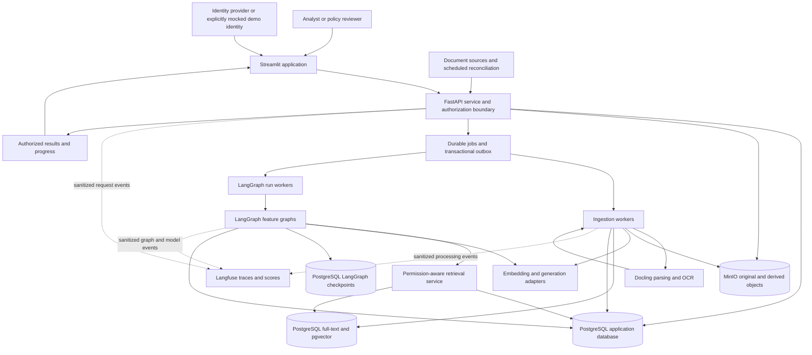

**Reading the diagram:** uploads and connector changes become durable jobs. Ingestion produces validated document versions. Query graphs retrieve only eligible evidence and persist results. Streamlit polls or streams authorized progress through the API. Langfuse observes execution; it does not hold authoritative business state or permissions.

The database, search, jobs, and checkpoint boxes are logical responsibilities. For the prototype, they can share one PostgreSQL deployment with separate schemas and credentials. MinIO remains a separate object store. Langfuse should be treated as a separate service with its own deployment dependencies and access policy.

## 2 LLD flow diagrams

### 2.1 Request routing and graph execution

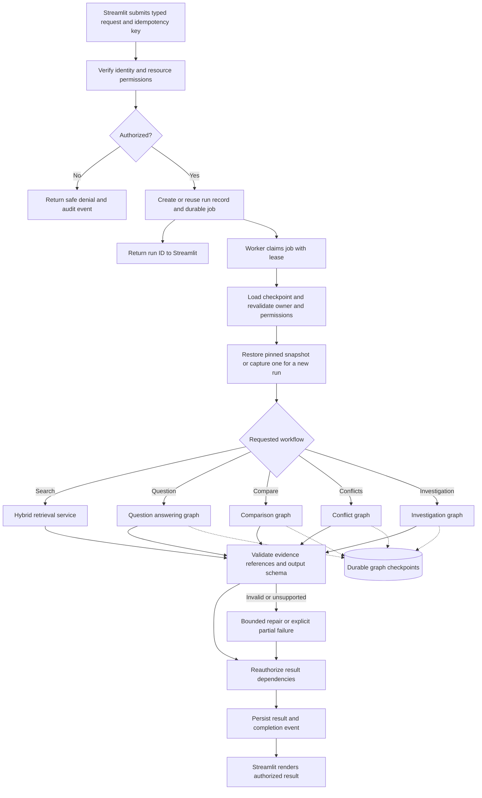

Use a validated workflow type selected by the user or an explicit router; do not let document text choose privileged tools. A graph checkpoint persists execution state, while a job lease and dispatcher determine which worker executes it. Checkpointing alone does not provide a job queue or exactly-once side effects.

### 2.2 Ingestion and daily change processing

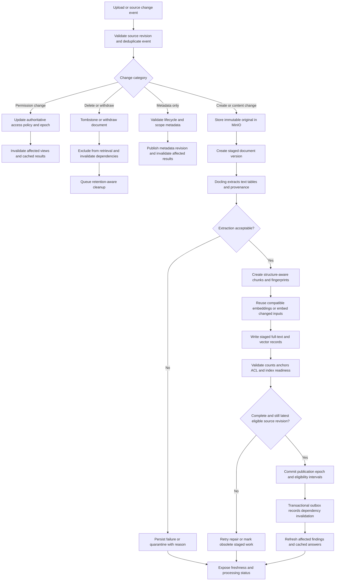

A content hash alone does not identify permission or lifecycle changes. Source revision ordering prevents a slow older job from replacing a newer published version. A content-identical copy from another source remains a separate logical document with its own permissions and authority.

### 2.3 Retrieval and cited answer graph

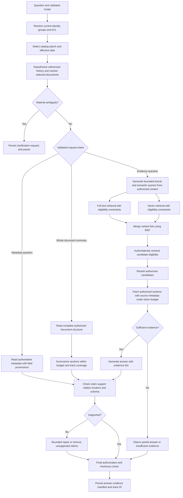

Full-text and vector queries must both apply the effective authorization and publication constraints. The authoritative recheck protects against stale candidate metadata; it is not permission to send unauthorized text to a reranker or LLM first. Approximate vector indexes can return too few eligible matches under restrictive filters; evaluate recall and use an exact-search fallback for small authorized scopes when appropriate. See [pgvector guidance on filtering and hybrid search](https://github.com/pgvector/pgvector).

### 2.4 Investigation graph and review loop

Concrete implementation follow-through is now specified in reasoning-and-investigation-plan.md (archived development reference): required A1–A4 milestones build on the retrieval foundation, with explicit multi-hop coverage checks, separate comparison/conflict subgraphs, bounded retries, durable review/resume, and a conditional numerical branch. This remains planned work; cross-document search alone does not implement the investigation graph below. The accepted snapshot implementation uses exact-version manifests within the 12-table design, rather than assuming the earlier conceptual catalog-epoch machinery exists.

Current scope refinement: reasoning-plan sections 4.1–4.2 require metadata/outline-guided subquery planning, evidence-dependent exploration, and complete subsection/parent fetching when a hit is incomplete. Retrieval R6 makes the context tools and real section mapping explicit prerequisites. Pandas/table querying and the numerical branch are deferred.

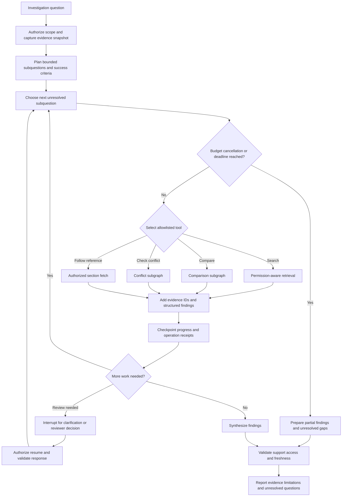

The graph state stores structured findings and evidence references. On resume, reconstruct authorized context instead of blindly replaying old document text or conversation history. LangGraph checkpointers support persisted thread state; use a durable backend rather than an in-memory saver for the submitted recovery scenario. See [LangGraph persistence](https://docs.langchain.com/oss/python/langgraph/persistence).

## 3 Feature inventory and acceptance criteria

The assignment explicitly requests document Q&A, comparisons, conflict identification, multi-step investigations, a working prototype, and a production-scale explanation. It also assesses usability, APIs, database design, visualizations, evidence, LLM efficiency, observability, feedback, security, and evaluation. The following inventory includes the supporting capabilities needed to demonstrate those requirements.

| ID | Feature | Basis | Observable completion criterion |
| --- | --- | --- | --- |
| F01 | Document ingestion | Explicit formats and end-to-end prototype | Upload produces a durable document and job ID; replaying the same request does not create duplicate work. |
| F02 | Extraction OCR and chunking | Explicit mixed formats | Native text, scans, and tables become structured evidence with valid source anchors; failures are visible. |
| F03 | Metadata and lifecycle | Supporting | Current, historical, future-effective, draft, withdrawn, and superseded documents are handled explicitly. |
| F04 | Search and discovery | Supporting | Relevant authorized documents can be found using exact terms and paraphrases. |
| F05 | Complex question answering | Explicit | Answer uses multiple relevant sources when necessary and abstains when support is insufficient. |
| F06 | Evidence and citations | Assessed | Each material claim links to the exact supporting version and locator. |
| F07 | Document comparison | Explicit | Changes are aligned, explained, and supported by both source versions. |
| F08 | Conflict detection | Explicit | Genuine scoped conflicts are identified; exceptions and nonoverlapping dates do not create false conflicts. |
| F09 | Multi-step investigations | Explicit | Run executes multiple evidence-gathering steps, exposes progress, and resumes after interruption. |
| F10 | Daily changes and history | Explicit operating context | Create, edit, delete, metadata, and permission events update the system without full-corpus reprocessing. |
| F11 | Access control and security | Assessed and explicit demo scenario | Restricted content is excluded from retrieval, model context, citations, history, exports, and unauthorized traces. |
| F12 | Streamlit UI and visualizations | Assessed | Users can inspect sources, versions, comparisons, findings, progress, and failure states. |
| F13 | Feedback handling | Assessed | Feedback is persisted, tied to a run and trace, reviewed, and usable as a regression case. |
| F14 | APIs and persistence | Explicit and assessed | Typed endpoints, examples, consistent errors, durable jobs, and documented schemas exist. |
| F15 | Langfuse observability | Assessed | A run can be diagnosed using correlated graph, tool, retrieval, model, token, latency, and error events. |
| F16 | Automated evaluation | Explicit and assessed | Labeled cases test evidence quality, conflicts, failures, freshness, and access isolation. |
| F17 | Performance cost and scaling | Explicit | Measured prototype results and assumption-based production estimates are reported separately. |

## 4 Sequence diagrams for each feature

Diagrams describe proposed behavior, not implemented endpoints. `API` means the FastAPI application boundary. `Catalog` means authoritative PostgreSQL document, permission, and publication state. Diagram participant labels describe logical roles; they do not require separate microservices.

### F01 Document ingestion

**Workflow:** validate upload and identity, register one logical document, store immutable bytes, and enqueue durable processing. An idempotency key is scoped to the caller and operation; reuse with different input is rejected.

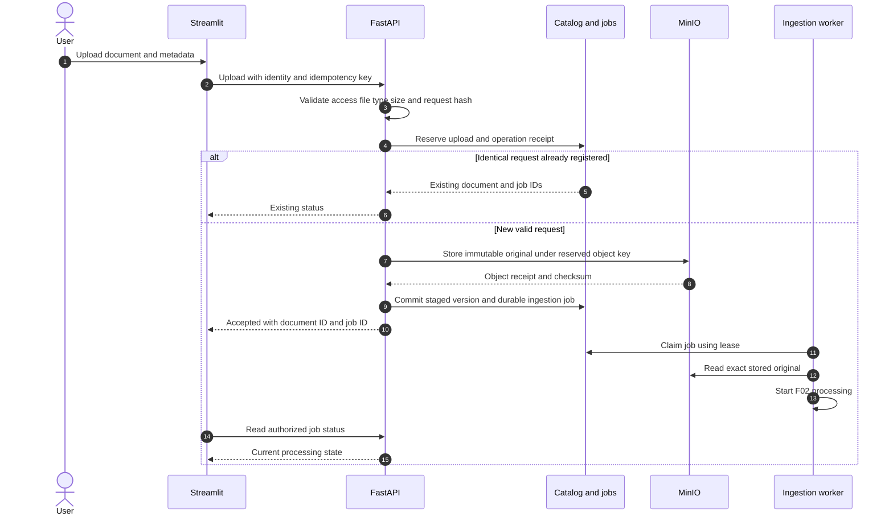

MinIO and PostgreSQL do not share a transaction. Use upload reservations, immutable keys, and a reconciler to handle a crash between object creation and database commit. Clean up abandoned uploads according to a documented retention window.

### F02 Extraction OCR and structure-aware chunking

**Workflow:** use Docling's structured document representation, preserve tables and locators, validate extraction, then create reproducible chunks. OCR is a processing step selected for scanned content, not an assumed success for every page. Source support must be verified for the chosen Docling version and legacy converters. See [Docling document model](https://docling-project.github.io/docling/concepts/docling_document/) and [chunking](https://docling-project.github.io/docling/concepts/chunking/).

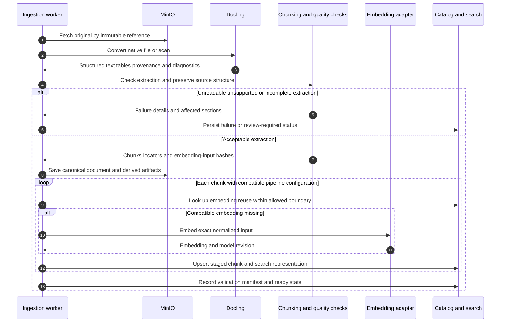

Embedding reuse keys include the actual embedding input, model revision, dimensions, normalization, and chunker configuration. Reuse numerical embeddings without merging source identities, citation anchors, or permissions. Do not expose cross-tenant cache-hit information.

### F03 Metadata approval and effective-date lifecycle

**Workflow:** validate owner-provided metadata, preserve its revision history, and update eligibility. A newly uploaded policy can be approved but future-effective. A withdrawn policy must disappear from current answers even if its bytes are unchanged.

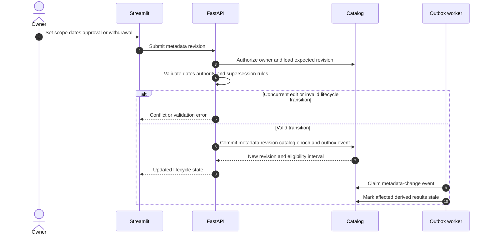

Effective-date selection happens at query time against published metadata. Future activation does not require re-embedding. Do not automatically choose regulatory precedence or cross-document authority from timestamps alone; capture explicit rules and escalate unresolved cases to a reviewer.

### F04 Hybrid search and document discovery

**Workflow:** filter by current authorization, publication snapshot, effective date, and user scope; retrieve exact and semantic matches; fuse and rerank only authorized candidates. A query graph can provide a bounded set of conversation-aware lexical and semantic queries. A direct search can use a single query. PostgreSQL full-text ranking is the prototype lexical method, not a claim that PostgreSQL natively supplies BM25. RRF combines ranked lists without requiring comparable raw scores. See the [hybrid search pattern](https://learn.microsoft.com/en-us/azure/search/hybrid-search-overview).

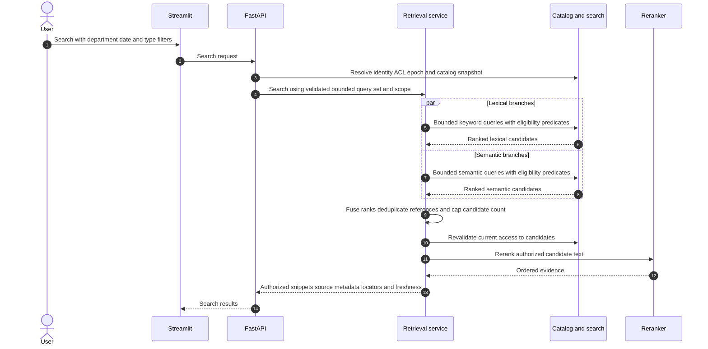

### F05 Complex question answering

**Workflow:** distinguish source statements, supported inference, and unknowns. Resolve follow-up questions using currently authorized history. Route metadata questions to catalog fields and complete-document summaries to structured document traversal; use bounded retrieval expansion for evidence questions. A retrieval score is not a calibrated probability that an answer is correct.

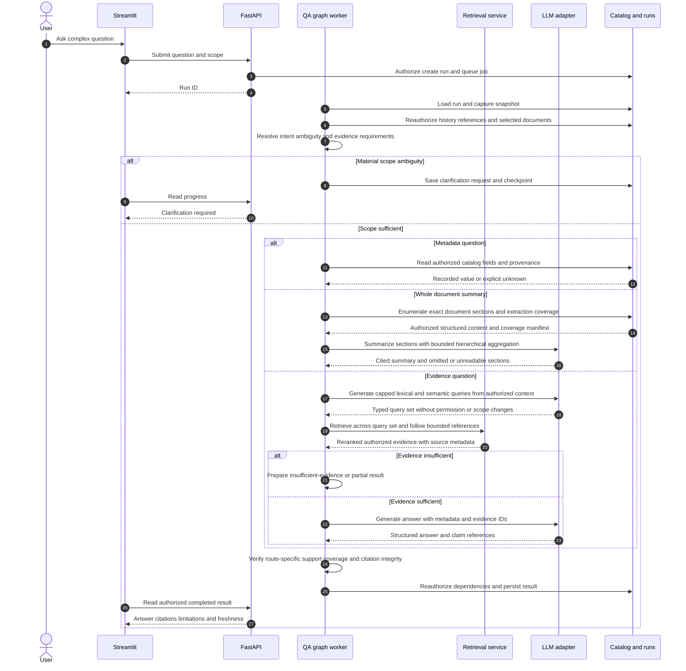

### F06 Evidence citations and source viewing

**Workflow:** persist exact provenance, then authorize every source-open action. Use physical pages and bounding boxes where extraction supplies them. For DOCX, use section or element anchors unless a stable rendered page map exists. Never invent page numbers.

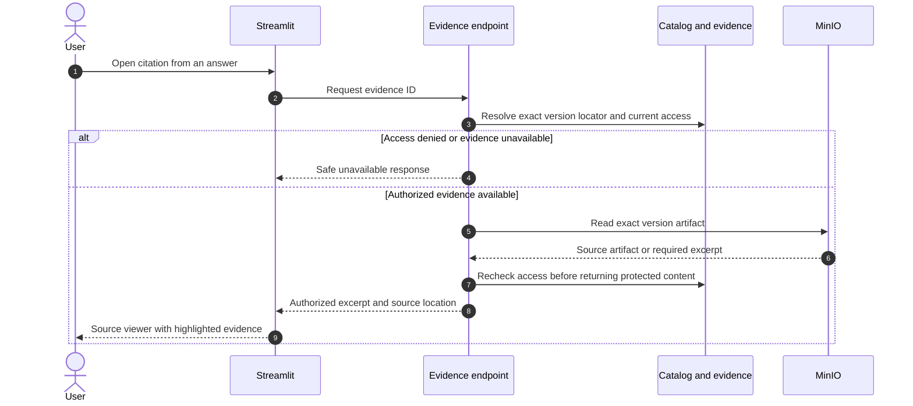

Default to backend-proxied protected viewing for revocable access. A presigned object URL is a bearer capability that can remain usable until expiry; it does not provide immediate application-level revocation by itself.

### F07 Document and version comparison

**Workflow:** align sections and tables, calculate deterministic changes, then ask the LLM to interpret their significance. Report added obligations, removed exceptions, changed dates, amounts, thresholds, and responsibilities separately from cosmetic edits.

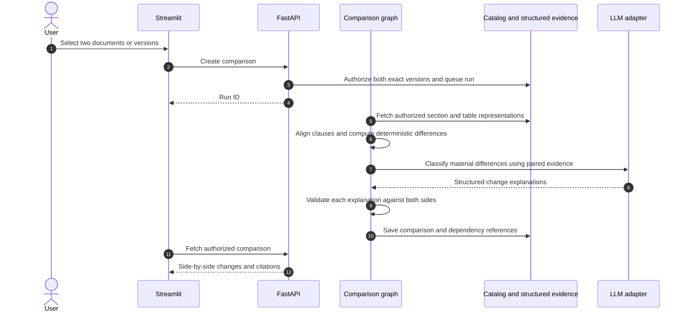

Missing sections must be labeled as unmatched rather than treated as proven deletions when extraction is incomplete. Table comparisons preserve row, column, and header context.

### F08 Policy conflict detection and review

**Workflow:** select candidate clauses by topic and overlapping scope, normalize obligations, evaluate compatibility, and present reviewable findings. Avoid comparing every document with every other document. Incremental runs compare changed clauses against relevant candidate neighborhoods.

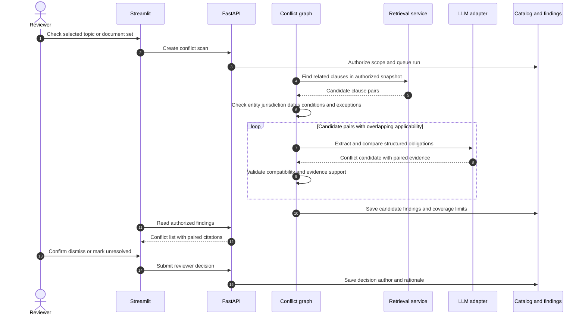

A five-year and seven-year retention statement may be compatible because of different record classes, exceptions, or dates. Findings need status such as candidate, confirmed, dismissed, unresolved, and stale. Candidate retrieval limits mean the system cannot claim an exhaustive corpus-wide absence of conflicts.

### F09 Multi-step investigations and recovery

**Workflow:** execute a bounded evidence-gathering graph, checkpoint progress, and preserve an auditable evidence trail. Human review is used for unresolved business judgments or missing scope; ordinary read-only tool steps do not need repeated approval.

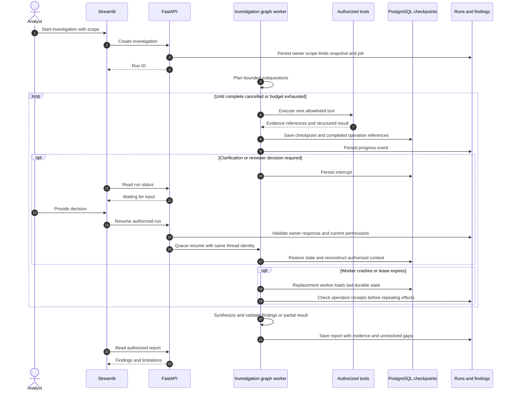

Persist cancellation requests and inspect them between graph steps. A model call already in progress may not stop immediately. Tool retries require timeouts, backoff, a retry budget, and application-level idempotency for writes.

### F10 Daily changes version publication and history

**Workflow:** combine source events with reconciliation; process only changed inputs; publish complete versions; invalidate dependencies. Permission-only changes and deletions follow their own immediate eligibility paths rather than waiting for embedding work.

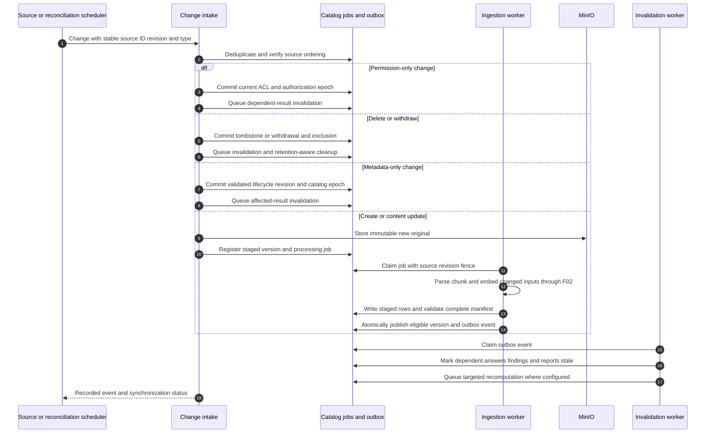

The intake acknowledgment records receipt; it must not imply that asynchronous processing has completed. A publication transaction checks that the staged revision remains eligible to supersede the current one. Older versions remain available only through authorized historical queries and the retention policy.

### F11 Access control permission revocation and document attacks

**Workflow:** enforce identity and current document policy before protected content is fetched into model context and before results are served. A user's browser selection of a role is not trustworthy authentication in production. Demo identity substitution must be explicitly labeled as mocked.

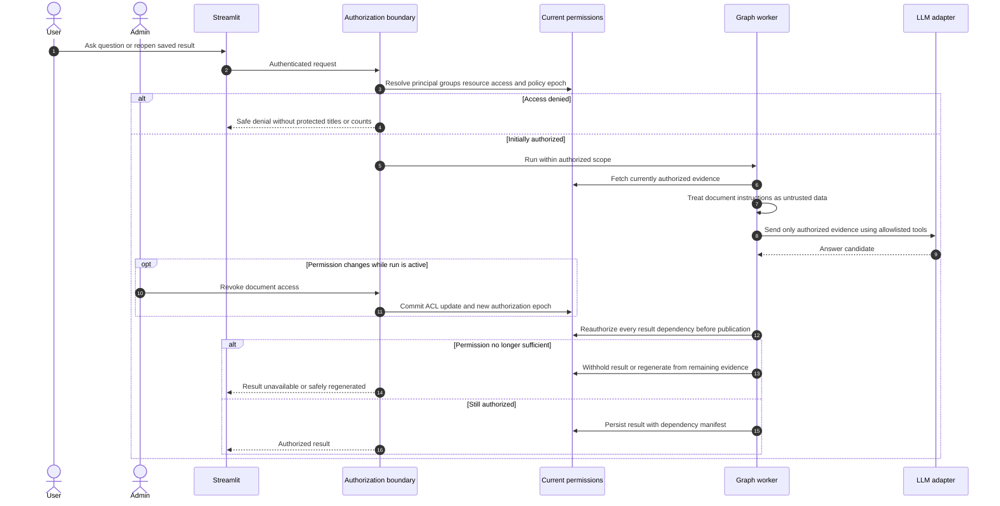

A final check cannot retract content already sent to an authorized user or model before revocation. Define the authorization decision boundary, cancel affected in-flight runs where possible, and enforce every subsequent request against current policy. Avoid long-lived bearer download URLs. Protect saved conversation text, graph state, exports, logs, and telemetry as well as search results. See [document-level access controls](https://learn.microsoft.com/en-us/azure/search/search-document-level-access-overview) and [OWASP RAG security](https://cheatsheetseries.owasp.org/cheatsheets/RAG_Security_Cheat_Sheet.html).

### F12 Streamlit UI progress and visualizations

**Workflow:** Streamlit collects inputs, renders evidence, and observes durable work. A rerun or browser disconnect must not create duplicate work or erase the investigation. Session state contains view state and run references; durable results remain in PostgreSQL.

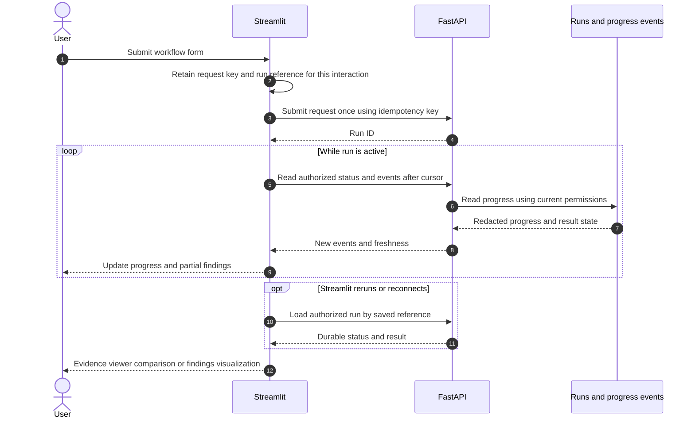

Recommended pages are Ask and Search, Documents, Compare, Conflicts, Investigations, and an admin-only Operations view. Show source freshness, dates, failure states, and review status. Use version timelines and evidence relationships where useful; no graph visualization is required for ordinary answers.

Streamlit global resource caches can be shared across users. Cache thread-safe clients where appropriate; keep request identity and user results out of globally shared mutable resources. Any result cache must include authorization and corpus dependencies and still recheck current access. See [Streamlit resource caching](https://docs.streamlit.io/develop/api-reference/caching-and-state/st.cache_resource).

### F13 Feedback review and regression cases

**Workflow:** record feedback as business data first, mirror an appropriate score to Langfuse asynchronously, review the issue, and add a regression case. User feedback is evidence of a problem to investigate, not an instruction to rewrite authoritative documents.

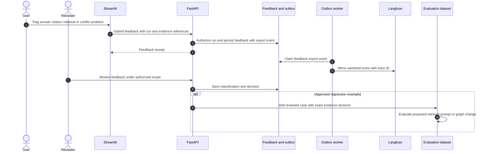

### F14 API contracts durable jobs and persistence

**Workflow:** the API validates requests and identity, registers idempotent operations, and returns durable job references for long work. Clients can safely retry requests and poll results. Resource authorization applies to every read, cancel, resume, and export operation.

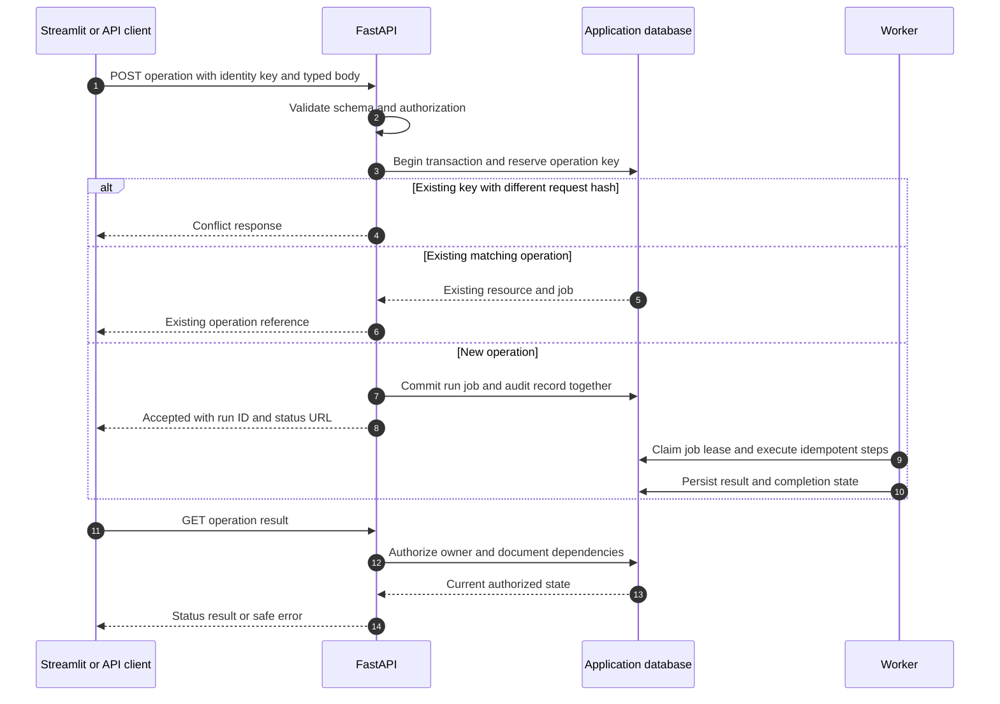

### F15 Langfuse traces and operational observability

**Workflow:** correlate requests, worker execution, graph nodes, tool use, retrieval, model generations, and feedback. Sanitize telemetry before export. Keep business audit events durable separately so a tracing outage does not lose the security record or block a valid answer.

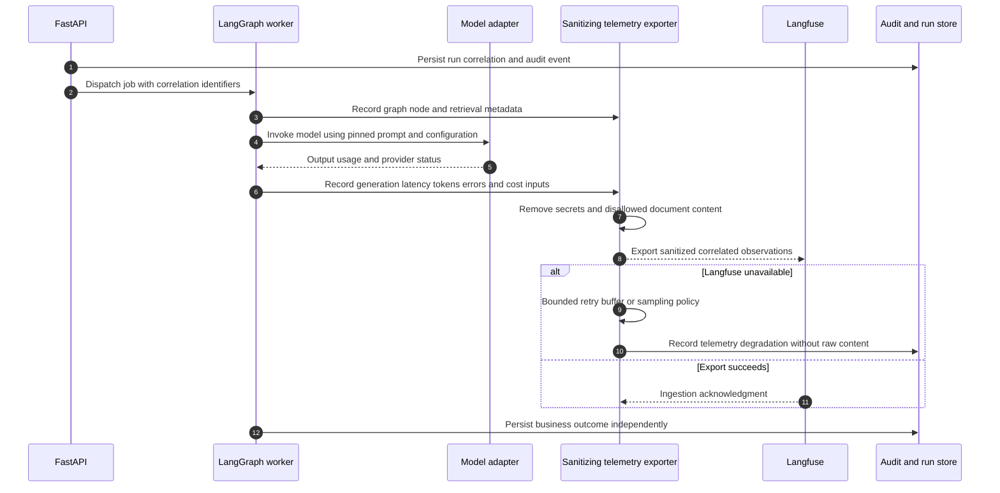

Langfuse supports LangGraph/LangChain tracing integration and masking. The exact SDK API must be pinned during implementation. No prompt, document, or model output should be assumed safe simply because it is useful for debugging. See [Langfuse integration](https://langfuse.com/integrations/frameworks/langchain) and [masking](https://langfuse.com/docs/observability/features/masking).

### F16 Automated tests and quality evaluation

**Workflow:** combine deterministic assertions with expert-reviewed answer and conflict cases. Evaluate retrieval separately from generation. LLM judges can assist scoring but do not replace deterministic permission checks or human review of ambiguous policy interpretations.

```mermaid
sequenceDiagram
    autonumber
    actor Engineer
    participant EV as Evaluation runner
    participant DS as Versioned labeled dataset
    participant API as Prototype API
    participant J as Assertions and optional judges
    participant LF as Langfuse scores
    participant R as Evaluation report
    Engineer->>EV: Evaluate pinned configuration and corpus snapshot
    EV->>DS: Load held-out questions sources conflicts and identities
    DS-->>EV: Cases expected evidence and labels
    loop Each test case
        EV->>API: Execute workflow using case identity
        API-->>EV: Result evidence trace and usage
        EV->>J: Score correctness support retrieval and security
        J-->>EV: Metric values and failure reasons
        EV->>LF: Attach reviewed or automated scores to trace
    end
    EV->>R: Write aggregate and per-case results
    R-->>Engineer: Regressions release criteria and known gaps
```

Test native text, OCR, tables, exact terms, paraphrases, multi-document questions, insufficient evidence, prompt injection, access revocation, deletions, future-effective policies, duplicate events, out-of-order revisions, and worker recovery. Test conflict false positives as carefully as true conflicts. Ragas metrics can be an optional evaluation aid; they are not a required runtime dependency. See [Ragas metric catalog](https://docs.ragas.io/en/latest/concepts/metrics/available_metrics/).

### F17 Performance measurements cost estimation and scaling

**Workflow:** measure the prototype under a declared workload, identify bottlenecks, and project production costs using explicit assumptions. Keep extrapolations separate from measured results. No latency, throughput, price, or accuracy result has been measured for this unimplemented design.

```mermaid
sequenceDiagram
    autonumber
    actor Engineer
    participant B as Benchmark runner
    participant API as Prototype API
    participant W as Worker pools
    participant DB as Metrics and workload records
    participant LF as Langfuse usage metrics
    participant C as Cost and capacity model
    Engineer->>B: Set corpus mix concurrency query mix and change rate
    B->>API: Execute controlled ingestion and query workload
    API->>W: Dispatch processing and graph jobs
    W->>DB: Record queue lag service times failures and index sizes
    W->>LF: Record model usage and generation latency
    B->>DB: Save workload parameters and measured percentiles
    C->>DB: Read storage throughput freshness and latency measurements
    C->>LF: Read tokens calls and available usage cost data
    C->>C: Apply dated provider prices and stated production assumptions
    C-->>Engineer: Measured results projections and uncertainty ranges
```

## 5 Component responsibilities and design decisions

| Component | Responsibility | Boundary |
| --- | --- | --- |
| Streamlit | Forms, chat, tables, evidence viewing, comparisons, timelines, and run progress | Does not own durable execution, service secrets, or authoritative permissions. |
| FastAPI proposed | Typed contracts, identity validation, resource authorization, run submission, status, evidence, and feedback | Does not perform long OCR or investigation loops inside an HTTP request. |
| LangGraph | Explicit QA, comparison, conflict, and investigation graphs with checkpoints and bounded tools | Does not replace the source catalog, queue, or application authorization checks. |
| Docling | Structured extraction, OCR routing, tables, document elements, and provenance | Does not determine legal authority, approval, or source permissions. |
| MinIO | Immutable originals, canonical extraction artifacts, rendering artifacts, exports, and evaluation data | Object latest-version semantics do not define the current applicable policy. |
| PostgreSQL proposed | Catalog, metadata history, ACLs, jobs, outbox, runs, evidence dependencies, feedback, and checkpoints | Separate schemas and roles prevent checkpoint or telemetry access from implying document access. |
| Full-text and pgvector proposed | Lexical and semantic candidate retrieval within eligible scope | Relevance ranking never grants access. |
| Model adapters | Embedding, optional reranking, structured extraction, and generation | Pin model revisions, track usage, and enforce timeouts and budgets. |
| Langfuse | Sanitized traces, prompt/configuration references, scores, evaluation correlation, and cost visibility | Not the business database, checkpoint authority, or unrestricted document archive. |
| Job dispatcher proposed | Claiming, leases, retries, backoff, dead-letter states, and recovery | Start with PostgreSQL jobs; add a dedicated broker only if measured load justifies it. |

Use a modular application and separately runnable workers for the prototype. Logical components do not require a fleet of microservices. An initial deployment can place application data, retrieval, checkpoints, and jobs on one database instance while maintaining schema and role separation.

If Langfuse is self-hosted, deploy the dependencies required by the selected Langfuse release separately; the simplified HLD does not claim that Langfuse runs on the application PostgreSQL database alone. If hosted, select an approved region and telemetry policy before exporting real document content.

MinIO's documentation currently routes versioning guidance to AIStor. Verify the chosen MinIO edition and release rather than assuming every documented deployment feature is identical. This design's correctness depends on immutable application object references and catalog history, not on optional bucket versioning alone. See [MinIO object versioning](https://docs.min.io/aistor/administration/objects-and-versioning/versioning/).

## 6 Data model and invariants

### 6.1 Logical entities

| Entity | Key information |
| --- | --- |
| documents | Stable document ID, tenant, source system and source ID, owner, classification, withdrawal or tombstone state. |
| document_versions | Version ID, document ID, source revision, checksum, immutable object reference, extraction configuration, processing state. |
| metadata_revisions | Approval, title, recorded author and field provenance, document type, department, jurisdiction, authority, effective interval, supersession links, actor, and recorded timestamp. |
| publication_history | Version and metadata revision, catalog epoch interval, readiness manifest, publisher, and publication time. |
| document_acl | Current document access rules, applicable version restrictions, policy revision, and authorization epoch. |
| chunks | Chunk ID, exact version and artifact, structure path, text or text reference, source locator, embedding-input hash, and index generation. |
| embeddings | Embedding-input identity, model revision, dimensions, normalization, and numerical vector. |
| source_cursors and source_events | Connector cursor, stable event ID, source ordering, event category, processing receipt, and reconciliation state. |
| jobs and outbox | Idempotency identity, request hash, operation type, lease, retry count, next attempt, terminal reason, and payload references. |
| runs and run_events | Owner, workflow type, status, limits, catalog snapshot, business date, thread ID, trace ID, progress, and error category. |
| graph checkpoints | Durable graph state in a dedicated schema using the selected supported checkpointer. |
| results and result_dependencies | Answer or report, structured claims, evidence references, exact versions and metadata revisions, freshness, and review state. |
| conflict_findings | Paired clauses, normalized obligations, applicable scopes, finding status, reviewer decision, and dependency manifest. |
| feedback and evaluation_cases | Run and trace references, issue type, reviewer decisions, labels, expected evidence, dataset revision, and access restrictions. |
| audit_events | Identity, action, resource references, decision, policy revision, time, and correlation IDs without unnecessary protected text. |

### 6.2 Nonnegotiable invariants

1. A logical document ID survives renames and revisions. Source identity and version identity are separate.
2. Published evidence is immutable and traceable to original bytes, extraction configuration, and source locators.
3. A staged or partially indexed version cannot enter ordinary retrieval.
4. Source revision fences prevent old asynchronous work from overwriting newer state.
5. Current permissions constrain every protected operation, including historical queries and run resumption.
6. Publication, metadata history, and business effective dates are separate concepts.
7. A saved result has an explicit dependency manifest; result access is rechecked even before asynchronous invalidation finishes.
8. Graph state is durable, but side effects remain idempotent because a worker or graph node may run again.
9. A failed replacement is visible. Continued use of the last validated version is labeled stale and can be blocked by a stricter freshness policy.
10. Citation locations are derived from actual extraction or rendering artifacts, never guessed.

### 6.3 Graph state contract

The proposed state contains `run_id`, owner and tenant references, `thread_id`, validated workflow inputs, `catalog_epoch`, effective date, known-at date if requested, evidence references, structured findings, pending subquestions, operation receipts, deadline, remaining token or step budget, cancellation state, interrupt state, and output validation status.

For conversation-aware requests, also record the validated intent, selected document IDs, authorized conversation references, query set, query-generator version, candidate budget, reranker configuration, context token budget, and summary coverage manifest where applicable. Conversation references preserve provenance; they do not grant continued access to previously visible content.

Do not use a checkpoint as an unrestricted transcript archive. Keep sensitive payloads minimal and access-controlled. A resumed graph must reauthorize the run and each evidence dependency before rehydrating context. Persist prompt, model, retriever, chunker, and graph versions so results can be reproduced where source retention permits.

## 7 Daily document changes in detail

### 7.1 Detection and reconciliation

Use source events or delta feeds where supported. Maintain a durable connector cursor and an event receipt ledger. A cursor advances after the change is durably registered, not merely received in memory. Scheduled reconciliation compares source identity and revisions with the catalog, detects missed events, checks deletion state where available, and reports discrepancies.

Do not depend only on modified timestamps. Content hashes detect byte changes, while source revisions, metadata revisions, and permission revisions detect other changes. A scanned document replaced with a better scan may have the same wording but still require updated extraction provenance.

### 7.2 Publication consistency

For the proposed PostgreSQL prototype, staged search rows and validated manifests are committed before publication eligibility changes. Publication history records catalog epoch intervals. A query captures an epoch and selects the version eligible at that epoch and requested business date. Old rows remain available for authorized retained snapshots instead of relying only on a mutable current-version flag.

Use an explicit per-policy date rule or exclusion constraint to prevent accidental overlapping effective intervals within one version lineage. Overlap between independent policies is allowed and may become a conflict candidate.

If search later moves to a separate service, publication cannot be a distributed transaction with it. Write immutable generation records, verify indexed readiness, and publish a catalog manifest. Retrieval checks the manifest and current ACLs before fetching text. Document the availability behavior while a new index generation is warming up.

### 7.3 Change handling matrix

| Change | Processing | Current-answer behavior |
| --- | --- | --- |
| New document | Validate original, parse, chunk, embed, stage, validate, publish. | Eligible only after publication, approval, effective-date, and permission checks. |
| Content edit | New immutable version; recompute affected structure and embedding inputs. | New version becomes eligible after complete validation; old version remains retained history. |
| Rename | Update source mapping and metadata history. | Logical identity remains unchanged; duplicate ingestion is avoided. |
| Metadata-only edit | Validate revision and scope; update catalog history. | Filters and applicability use the selected metadata revision; no embedding call unless its input changes. |
| Permission revocation | Update authoritative ACL and epoch; invalidate dependencies. | New operations and saved-result reads are denied using current policy without waiting for an indexing job. |
| Deletion or withdrawal | Tombstone or withdraw immediately; queue derived cleanup. | Excluded from current retrieval; historical access depends on retention and current policy. |
| Future-effective version | Process and publish with future applicability. | Excluded from today's default answers; available for explicitly authorized future-date analysis. |
| Failed replacement | Record failure; retry or quarantine; preserve valid history. | Clearly display source freshness; optionally block current answers if policy requires it. |
| Parser or embedding migration | Build a new artifact/index generation and evaluate it. | Switch only to a compatible validated generation; never mix incompatible vector dimensions or models. |
| Out-of-order source event | Compare source ordering and current revision before publication. | Obsolete work cannot supersede newer content. |

### 7.4 Time semantics

Store business validity, source revision time, system observation time, publication time, and supersession or withdrawal state separately. Full historical questions require retaining revisions of metadata and policy state, not just old file bytes.

- **Current question:** choose approved, published, currently effective evidence under current permissions.
- **As-of business-date question:** choose evidence effective on that date using the requested knowledge cutoff or the current catalog, and state which interpretation was used.
- **Known-at question:** restrict to information the system had published by the requested historical point.
- **Investigation snapshot:** pin a catalog epoch and exact retrieved evidence versions. New publications do not silently alter a running investigation; mark affected results stale or explicitly restart it.

Historical time selection never restores access that has since been revoked. Current access checks still apply. Define freshness targets separately for content publication and permission propagation; the latter cannot rely on an eventual search-index refresh.

### 7.5 Dependency invalidation

Persist an edge from each answer claim, comparison, conflict finding, and investigation report to the evidence and metadata revisions it used. When a dependency changes, mark the result stale and expose the reason. Recompute only authorized, still-relevant results according to a configurable policy.

Topic-scoped conflict scans also depend on the searched scope and catalog generation. A newly added document may introduce a conflict even though no existing evidence dependency changed. Invalidate or rescan affected topic/scope subscriptions for creates and metadata changes as well as direct version dependencies.

## 8 Proposed API surface

These are design contracts to document and implement later; no service currently exists. The assignment requires API documentation with request and response examples, so Streamlit does not remove the need for a documented service boundary.

| Method and route | Purpose |
| --- | --- |
| `POST /v1/documents` | Upload/register a document and return document, version, and processing job references. |
| `GET /v1/documents/{document_id}` | Read authorized catalog details and freshness. |
| `GET /v1/documents/{document_id}/versions` | List authorized retained version history. |
| `PATCH /v1/documents/{document_id}/metadata` | Apply a validated metadata revision with optimistic concurrency. |
| `PUT /v1/documents/{document_id}/permissions` | Authorized policy administration; not available to the LLM toolset. |
| `DELETE /v1/documents/{document_id}` | Logical deletion or withdrawal under configured policy, not automatic permanent purge. |
| `POST /v1/search` | Return authorized hybrid search results. |
| `POST /v1/questions` | Start an answer run. |
| `POST /v1/comparisons` | Start a document or version comparison. |
| `POST /v1/conflict-scans` | Start a scoped conflict scan. |
| `POST /v1/investigations` | Start a bounded investigation. |
| `GET /v1/runs/{run_id}` | Read authorized progress, status, and available result. |
| `GET /v1/runs/{run_id}/events` | Read ordered progress events using a cursor; polling is sufficient for the prototype. |
| `POST /v1/runs/{run_id}/resume` | Provide validated input for a paused graph. |
| `POST /v1/runs/{run_id}/cancel` | Request cooperative cancellation. |
| `GET /v1/evidence/{evidence_id}` | Open exact authorized evidence with source locator. |
| `POST /v1/feedback` | Persist feedback against an authorized run or finding. |
| `POST /v1/conflicts/{finding_id}/review` | Record an authorized reviewer decision. |
| `GET /v1/operations/sync-status` | Admin-only connector, queue, extraction, and publication health. |

Example question request body, with identity supplied by the authenticated session rather than a client-selected role:

```json
{
  "question": "Which approved retention policies apply to customer onboarding records?",
  "scope": {"department": "Operations", "document_types": ["policy", "procedure"]},
  "effective_on": "2026-11-15"
}
```

Example accepted response, illustrating a contract rather than an observed execution:

```json
{
  "run_id": "run_example_001",
  "status": "queued",
  "status_url": "/v1/runs/run_example_001"
}
```

Example completed result envelope:

```json
{
  "run_id": "run_example_001",
  "status": "completed",
  "catalog_epoch": 42,
  "effective_on": "2026-11-15",
  "result": {
    "answer": "Illustrative answer text would appear here.",
    "claims": [{"text": "Illustrative supported claim", "evidence_ids": ["ev_example_001"]}],
    "limitations": []
  },
  "evidence": [{
    "evidence_id": "ev_example_001",
    "document_id": "doc_example_001",
    "version_id": "ver_example_002",
    "locator": {"kind": "section", "path": "Retention / Onboarding records"}
  }],
  "freshness": {"state": "current", "checked_at": "2026-11-15T12:00:00+05:30"},
  "trace_id": "trace_example_001"
}
```

Every example above is synthetic. Define a common error envelope with a safe message, error category, request ID, retryability, and optional validation details. Avoid errors that reveal the title, existence, or count of protected documents. Use consistent status codes, including conflict for idempotency-key misuse and optimistic-concurrency failure. A timeout should not erase the durable run reference.

## 9 Evaluation and demonstration plan

### 9.1 Representative dataset

Use a curated, explicitly synthetic or approved dataset rather than attempting to ingest one million files for the assignment. The dataset should include contracts, policies, regulatory guidelines, and internal procedures across multiple departments.

Include native PDFs, scanned PDFs, DOCX, representative legacy conversions, tables, cross-references, superseded versions, future-effective policies, exact duplicates with different source ACLs, genuine conflicts, apparent conflicts resolved by scope, restricted documents, unreadable inputs, and unanswerable questions. Choose counts that permit manual labeling and publish the actual composition; no arbitrary dataset size is an assignment requirement.

### 9.2 Required demonstration scenarios

1. Ask a multi-document question and open the supporting citations.
2. Compare two policy versions and inspect a changed obligation or exception.
3. Detect a genuine conflict and dismiss a superficially similar non-conflict correctly.
4. Run an investigation with visible steps, evidence links, gaps, and a resumable interruption.
5. Publish a document update, show the changed current answer, and open the old authorized history.
6. Demonstrate deletion or withdrawal and a permission revocation affecting a saved result.
7. Show an OCR/extraction failure or unsupported question with an explicit explanation instead of fabricated evidence.
8. Execute the same question as two identities with different permissions and verify isolation.
9. Submit feedback, review the issue, and show the linked regression case or Langfuse score.
10. Show one trace connecting retrieval, tool calls, generation, evidence versions, latency, tokens, and errors.

### 9.3 Metrics and release evidence

| Area | Measurement |
| --- | --- |
| Retrieval | Recall at k against labeled evidence, ranking quality, exact identifier retrieval, and recall under restrictive ACL filters. |
| Routing and follow-ups | Correct metadata, document-summary, and evidence-question routing; referent resolution; clarification when a previous document is unavailable. |
| Summary coverage | Required-section coverage, table coverage, citation support, extraction gaps, and explicit disclosure of budget-limited omissions. |
| Answer quality | Correctness, evidence faithfulness, citation precision and coverage, and appropriate abstention. |
| Comparison | Detection of labeled clause/table changes and correctness of material-change classification. |
| Conflicts | Precision and recall on labeled overlapping-scope cases; false positives from exceptions and date differences. |
| Investigations | Coverage of required subquestions, supported findings, unresolved-gap reporting, tool efficiency, and recovery correctness. |
| Security | Deterministic cross-user isolation, restricted evidence absence, history/export access, revocation handling, and prompt-injection tests. |
| Freshness | Source-change to publication lag, permission-update visibility, stale-result detection, and missed-event recovery. |
| Reliability | Duplicate-request handling, out-of-order revision safety, retry behavior, lease recovery, and failure visibility. |
| Performance | Queue wait, OCR pages per unit time, ingestion throughput, retrieval latency, answer time, investigation time, and error rate. |
| Efficiency | Input/output tokens, embedding calls, reranker calls, graph steps, compatible reuse rate, and estimated cost per workflow. |

Report per-case failures as well as aggregate scores. Keep evaluation identities and document snapshots versioned. Use separate held-out cases when tuning prompts or retrieval. Agree acceptance targets after establishing a measured baseline; no invented scores should appear in the submission.

## 10 Scale and cost model

One million documents does not uniquely determine infrastructure. Measure average pages, OCR fraction, chunk count, embedding dimensions, retained versions, daily change rate, concurrent users, and the mix of questions versus investigations.

Useful capacity relationships are:

- Active chunk count = active documents multiplied by average chunks per document, plus retained indexed history.
- Raw vector bytes = vector count multiplied by dimensions multiplied by bytes per stored component; index and row overhead are additional.
- Daily embedding volume = changed embedding inputs multiplied by average tokens per input; parser/chunker changes can expand this set.
- OCR workload = newly processed scanned pages plus reprocessed pages; unchanged documents do not need daily OCR.
- Model workload = calls per workflow multiplied by workflow volume, including bounded retries and evaluation runs.
- Freshness = change-detection delay plus queue wait plus processing and publication time; measure permission handling separately.

Monthly cost estimates should show object storage, database and index capacity, worker compute, OCR where separately charged, embeddings, reranking, generation, network transfer, observability, backups, and operational overhead. Apply current dated provider or infrastructure prices when implementation choices are known. Langfuse model costs are one input, not the complete infrastructure bill.

Scale parsing workers separately from interactive graph workers. Apply backpressure, per-source rate limits, model quotas, and tenant-aware resource limits. Partition or move retrieval only when representative benchmarks show a bottleneck. A dedicated search service can later replace the retrieval adapter without moving authoritative publication and access decisions out of the catalog.

## 11 Build order and production roadmap

This is a proposed implementation order for later work, not authorization to start implementing now.

| Stage | Scope | Evidence needed before the next stage |
| --- | --- | --- |
| 1 Foundations | Identity boundary, document schema, MinIO artifacts, jobs, metadata and version lifecycle. | Idempotent ingestion and authorized version access. |
| 2 Extraction and retrieval | Docling, chunk provenance, hybrid retrieval, source viewer. | Labeled extraction and retrieval cases, including scans and ACL filters. |
| 3 Cited QA | LangGraph QA, support validation, abstention, Langfuse traces. | Correct multi-document answers and safe unsupported-question behavior. |
| 4 Daily changes | Incremental processing, publication history, deletion, revocation, reconciliation, invalidation. | No mixed versions, visible failed replacements, and safe saved-result access. |
| 5 Compare and conflicts | Alignment, material-change explanations, scoped obligation comparisons, review states. | True-conflict and false-conflict labels with paired citations. |
| 6 Investigations and feedback | Bounded tool graph, checkpoints, cancellation, review/resume, feedback loop. | Recovery demo, evidence completeness, and linked regression case. |
| 7 Submission and scale explanation | OpenAPI examples, setup, demo script, architecture, measurements, costs, limitations, and roadmap. | Reproducible clean setup and complete assignment checklist. |

Instrument and evaluate every stage rather than postponing observability or security until the end. Prioritize production identity integration, real source connectors and ACL fidelity, robust OCR validation, disaster recovery, representative load testing, retention policy, and operational runbooks after the prototype's core workflows are demonstrated.

## 12 Known limitations and open decisions

- There is no existing implementation to evaluate, and all diagrams describe proposed behavior.
- The shared conversation is intentionally excluded; no findings are attributed to its unread messages.
- FastAPI, PostgreSQL, pgvector, a PostgreSQL job dispatcher, and an identity provider are recommendations awaiting implementation-time selection.
- Model providers, embedding dimensions, reranking strategy, OCR configuration, supported legacy formats, and deployment regions remain undecided.
- The chosen MinIO edition and Langfuse deployment must be confirmed before infrastructure sizing or feature assumptions are finalized.
- Automatic conflict detection is a candidate-finding aid with measured coverage, not a guarantee of exhaustive policy consistency or a final authority decision.
- Retention and deletion policies determine which historical evidence can remain available; the assistant cannot recreate purged source evidence.
- Revocation prevents subsequent authorized service reads but cannot retract content previously disclosed while access was valid.
- Large-corpus performance and cost remain estimates until tested against a representative workload.
- Mocked identities, connectors, model responses, or external systems must be labeled wherever used. The assignment permits mocks only when identified explicitly.

## 13 Assignment submission checklist

- Working application with setup instructions and a demonstration dataset.
- Short demonstration of the main workflows, a failure case, and an access-control scenario.
- API documentation with example requests and responses.
- Architecture diagram and explanation of major design decisions.
- Automated tests and evaluation results.
- Performance measurements and a cost estimate with stated assumptions.
- Known limitations and a prioritized production roadmap.
- Explicit list of mocked components and the boundary between prototype evidence and production projections.

This Markdown file supplies the design and workflow specification. It does not claim that the working application, tests, benchmarks, or remaining submission artifacts already exist.

## 14 Sources and evidence

### User-provided material

- [Interview assignment](../../interview_assignment.docx), reviewed from its document XML. It defines the problem, deliverables, scope allowance, and assessment criteria.
- User stack selection in this conversation: Streamlit, LangGraph, Docling, MinIO, and Langfuse.
- The user requested analysis and documentation only, and later instructed that the shared conversation be left aside.

### Primary technical references

The following support individual technology capabilities and patterns. The assembled architecture, component boundaries, schemas, workflows, and prioritization are recommendations for this assignment rather than claims that one vendor prescribes this exact system.

1. [Streamlit resource caching](https://docs.streamlit.io/develop/api-reference/caching-and-state/st.cache_resource) — resource sharing and isolation considerations.
2. [LangGraph persistence](https://docs.langchain.com/oss/python/langgraph/persistence) — persisted thread state and checkpoints.
3. [Docling document model](https://docling-project.github.io/docling/concepts/docling_document/) — structured content and provenance.
4. [Docling chunking](https://docling-project.github.io/docling/concepts/chunking/) — chunking structured document representations.
5. [pgvector official repository](https://github.com/pgvector/pgvector) — vector retrieval, filtering considerations, and hybrid-search guidance.
6. [Microsoft hybrid search overview](https://learn.microsoft.com/en-us/azure/search/hybrid-search-overview) — lexical/vector retrieval and RRF pattern; this does not select Azure as the platform.
7. [Microsoft incremental indexing](https://learn.microsoft.com/en-us/azure/search/search-howto-create-indexers) — change detection and incremental processing.
8. [Microsoft change and deletion detection](https://learn.microsoft.com/en-us/azure/search/search-how-to-index-azure-blob-changed-deleted) — deletion handling as a distinct synchronization concern.
9. [Microsoft document-level access controls](https://learn.microsoft.com/en-us/azure/search/search-document-level-access-overview) — permission-aware retrieval principles.
10. [OWASP RAG security guidance](https://cheatsheetseries.owasp.org/cheatsheets/RAG_Security_Cheat_Sheet.html) — security concerns throughout the retrieval and generation pipeline.
11. [Langfuse LangChain and LangGraph integration](https://langfuse.com/integrations/frameworks/langchain) — correlated tracing integration.
12. [Langfuse masking](https://langfuse.com/docs/observability/features/masking) — sanitization before telemetry export.
13. [MinIO object versioning](https://docs.min.io/aistor/administration/objects-and-versioning/versioning/) — object revisions; verify edition-specific capabilities.
14. [Ragas metric catalog](https://docs.ragas.io/en/latest/concepts/metrics/available_metrics/) — optional retrieval and answer-quality evaluation support.

References were consulted on 15 November 2026. Pin and recheck dependency versions and edition-specific documentation during implementation.

### Additional practitioner reference

- [Production RAG what I learned from processing 5M documents](https://blog.abdellatif.io/production-rag-processing-5m-documents), published 20 October 2025; reviewed 15 November 2026. See Section 15 for findings and proposed adaptations.

## 15 Production RAG article review and design additions

### 15.1 Findings reported by the author

The [article](https://blog.abdellatif.io/production-rag-processing-5m-documents) reports that early small-dataset results failed to predict user satisfaction at scale. Its main lessons are conversation-aware generation of keyword and semantic queries, reranking, coherent chunks, source metadata in model context, and routing non-retrieval tasks separately. The reported reranking configuration takes 50 candidates to 15 results; it is a workload-specific observation. The article describes deployments in pages, despite the document-count headline, and provides no reproducible ablation or production sizing benchmark. Its database and model choices are experience reports rather than demonstrated winners. It does not specify our daily-update or access-control design.

### 15.2 Our proposed adaptations

The following are design recommendations for this assignment. They are not results measured by the article or by this project. The HLD service boundaries remain appropriate; LLD 2.3 and the F04 and F05 sequences now make request routing, authorized conversation context, query-set limits, and source metadata explicit.

Metadata routing and complete-document summaries are supporting additions, not separately mandated assignment features. They remain within F05 so the existing feature IDs and their sequence diagrams stay stable.

**Resolve conversation context before generating queries.** Bind a follow-up such as "does that apply to contractors?" to the selected topic, business date, and authorized document references. Revalidate referenced evidence before reconstructing history. If the earlier document is no longer accessible, ask for permitted scope instead of reusing its text. Generated queries cannot broaden the caller's authorized department, document set, dates, or tenant. Validate generated output against a typed schema and the run's fixed scope.

**Treat query generation as a budgeted optional step.** Preserve exact identifiers and citations from the user's question. Avoid expansion when one precise lookup is sufficient. For complex evidence questions, execute a capped query set with bounded concurrency and timeouts. Deduplicate by exact version and evidence identity, retain query provenance for diagnostics, and limit the union before sending it to a reranker. Compare alternative fusion policies through evaluation rather than assuming one policy is universally best.

**Make reranking an independently measured stage.** Keep candidate count, selected count, and context token budget as different controls. Selecting a fixed number of chunks does not guarantee that they fit the model context or contain all needed evidence. Apply document and clause diversity where required by the question, preserve paired evidence for comparisons and conflicts, and recheck eligibility before loading candidate text. Record pre-rerank and post-rerank evidence IDs so missed-source errors can be diagnosed.

**Review actual Docling outputs.** Build a chunk inspection view showing source structure, extracted text, headers, table context, token count, source anchors, and validation status. Include split tables, footnotes, repeated headings, cross-references, and OCR errors in the inspection sample. Store chunker configuration and embedding-input identity so a changed title, heading prefix, or normalization rule triggers compatible reprocessing instead of silently reusing an obsolete embedding.

**Construct a typed evidence envelope.** For each excerpt, supply only relevant fields: evidence ID, title, exact version, document type, section, effective interval, lifecycle status, recorded author if available, and source locator. Distinguish recorded author, document owner, and approving authority; one field cannot stand in for another. Label missing metadata as unknown. Delimit source metadata and text as untrusted evidence, and exclude unnecessary personal data from prompts and telemetry.

**Choose a workflow matching the request.** "Who authored this document?" reads an attributable metadata field and reports unknown when absent. "Summarize this document" enumerates the complete selected version and uses section-level aggregation when it exceeds the token budget. It must track unreadable or omitted sections instead of presenting retrieved excerpts as complete coverage. Evidence questions continue through hybrid retrieval. Comparisons and conflict scans retain their dedicated graphs. All branches pass the same authorization, provenance, and output checks.

**Evaluate with task-specific users and edge cases.** Add follow-up conversations, ambiguous pronouns, absent metadata, long-document summaries, tables, clause exceptions, and revoked-history scenarios to the held-out dataset. Domain reviewers should judge whether the result answers the operational question and uses the correct policy date. Keep correctness, evidence coverage, latency, and cost visible separately; a faster route is useful only when it preserves the task's required coverage.

### 15.3 Proposed experiments before choosing defaults

These are suggested experiment values, not validated defaults or article results. Pin the corpus snapshot, identities, graph version, model versions, and prompts for each run. Change one retrieval control at a time where possible and report per-case outcomes as well as aggregates.

| Experiment | Proposed variants | Decision evidence |
| --- | --- | --- |
| Authorized conversational rewriting | Last question alone versus resolved authorized context; query caps of 1, 3, and 5. | Follow-up correctness, labeled-source recall, wrong-referent rate, token use, and latency. |
| Reranking | No reranker versus capped candidate pools of 20, 50, and 100; selected counts of 5, 10, and 15 subject to context budget. | Relevant-evidence retention, paired-clause coverage, context tokens, p95 time, and request cost. |
| Evidence formatting | Excerpt alone versus excerpt plus the minimal typed source envelope. | Version/date attribution, citation accuracy, unsupported-author claims, and added context size. |
| Chunk configurations | Existing structure-aware baseline versus reviewed section/table boundary adjustments. | Retrieval recall on exceptions and tables, source-anchor validity, chunk count, and reprocessing cost. |
| Route selection | Explicit UI intent and deterministic rules versus a constrained classifier for ambiguous cases. | Route accuracy, unnecessary model calls, summary coverage, safe clarification, and end-to-end quality. |

### 15.4 Langfuse measurement additions

Extend run observations with route, query count, query-generator version, candidate counts by retrieval branch, deduplicated count, reranker configuration, selected evidence count, context token count, summary coverage, and fallback reason. Store protected query text or excerpts only when permitted by the telemetry policy; identifiers and aggregate counts still need the correct access restrictions.

Link reviewed feedback to the exact run and experiment configuration. A missed clause should be classified as extraction, chunk boundary, candidate retrieval, reranking, context-budget, routing, or generation failure before a prompt change is proposed. This categorization is our diagnostic design, not an outcome claimed by the article.

### 15.5 Effect on daily changes and stack selection

The chosen Streamlit, LangGraph, Docling, MinIO, and Langfuse stack remains the design baseline. No database, model, embedding, or reranker vendor is selected solely because it appears in the article. Evaluate alternatives only against the same labeled workload and operational constraints.

Dependency tracking now also includes metadata used in evidence envelopes, document-summary coverage, and authorized conversation references. A title, author, effective-date, or policy-status correction can invalidate an answer even if its paragraph text is identical. A cached summary depends on the complete selected version and extraction generation. Query-result caches additionally depend on the validated query set, route, publication snapshot, and current authorization checks. Permission revocation continues to bypass slow extraction and embedding work.

Only this design document was changed. No retrieval experiments, API endpoints, model calls, or application components have been implemented as part of this review.
