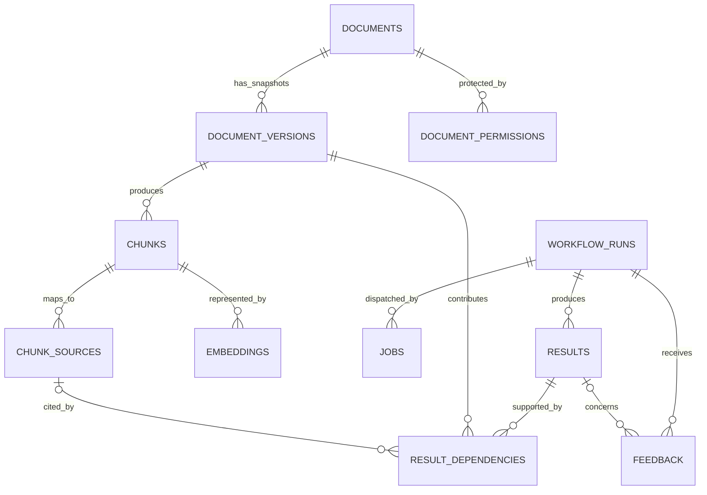

> Design reference: includes proposed production/future behavior. The README coverage and limitations describe the implemented submission.

# Chunking Review and Database Design for the Assignment

Retrieval/agent implementation status (15 November 2026): the same **12 application tables** now support scoped search and durable agent runs. Agent runs use nullable `document_id`, version manifests in MinIO, validated scope/parent references in `input_json`, an iteration limit in `config_snapshot`, and existing results/dependencies for checked answers. `jobs` dispatches ingestion and agent work with leases/fences. New section-map artifacts give actual enclosing-section IDs; legacy evidence is mapped read-only from its retained canonical JSON without rewriting published chunks. No new table or database column was needed. `.env` configures the shared exploration loop through `AGENT_MAX_ITERATIONS` (default and hard maximum five).

Implementation update (15 November 2026): the UI/ingestion code now initializes all **12 application tables** under `app`; LangGraph owns a separate `checkpoints` schema, and self-hosted Langfuse owns separate infrastructure. The default embedding representation is pinned `BAAI/bge-base-en-v1.5`, **768 dimensions**, with exact-tokenizer chunk limits. Vector dimensions and model signature are stored per representation so later retrieval can filter compatible spaces. Results/dependencies/feedback remain minimal reserved tables for later features. The detailed attributes below are the target specification; see [backend/db.py](../../backend/db.py) for the implemented first-slice columns and [README.md](../../README.md) for current behavior. No changes were made to the external chunker being reviewed.

Prepared on 15 November 2026. This document reviews the specifically requested `hybrid_markdown_chunker.py` and proposes database tables for the Document Intelligence and Investigation Assistant assignment. It does not describe the existing multimodal RAG project's database. Findings from other multimodal RAG files are excluded, in accordance with the user's instruction.

The recommendation is PostgreSQL with pgvector for application state and retrieval, MinIO for original and derived artifacts, LangGraph's supported PostgreSQL checkpointer for graph state, and Langfuse for sanitized observability. Streamlit remains the UI. These are design specifications; no database, migrations, application changes, or fixes to the reviewed chunker were implemented.

Related architecture and feature workflows are in [document-intelligence-design.md](architecture.md).

Retrieval planning update: retrieval-implementation-plan.md (archived development reference) proposes hybrid search using the existing `documents`, `document_versions`, `document_permissions`, `chunks`, `chunk_sources`, and `embeddings`, with `audit_events` for request outcomes. It needs **no additional tables or baseline column changes**. Reuse the existing GIN index, begin with exact compatible-vector search, and add ANN/index migrations only after measurement. Select the authoritative applicable revision before model compatibility filtering, so model changes cannot cause an older policy to be silently substituted. This update describes proposed work only.

Reasoning planning update: reasoning-and-investigation-plan.md (archived development reference) maps multi-hop QA, comparisons, conflict findings/review, and investigations onto existing runs, jobs, results, dependencies, feedback, audit events, and LangGraph checkpoints. Versioned JSON payloads and restricted MinIO manifests hold plans, evidence ledgers, finding IDs, calculation lineage, and review decisions. Parent-linked owned runs support follow-ups without a new session table. The application remains at **12 tables**; multi-document run authorization/dispatch must be extended before those workflows work.

Section-expansion planning update: current chunk `section_ref` stores the first contributing item, not a verified enclosing subsection. Add a versioned section-map and chunk-to-section membership artifact in MinIO, linked through the existing artifact manifest, to support authorized outlines and complete subsection/parent fetching. Record stable namespaced IDs, ordered item refs, parent/child relations, and boundary/coverage status. Duplicate headings and PDF batch boundaries must not cause guessed merges. This needs no new table; existing published evidence should gain the mapping through a new processing revision. Pandas/table-query execution and numerical analysis are deferred in the current reasoning scope.

## 1 Main conclusions

1. Retain the chunker's heading context, paragraph packing, and table-header ideas, but do not assume its stated equivalence to Docling means equivalent provenance or correctness.
2. Prefer the native Docling document structure for this assignment. If Markdown chunking is used, carry an explicit source map through every split and merge.
3. Validate the exact final embedding input with the effective tokenizer after all transformations. The reviewed implementation does not guarantee its final token limit.
4. Keep logical documents, immutable revision snapshots, chunks, source maps, and embeddings separate. Preserve metadata and processing history inside revision snapshots under the accepted 12-table design.
5. Store source locations as relationships, not a single page number on a chunk. A chunk may contain multiple source spans, pages, table rows, or repeated headers.
6. Treat PostgreSQL as the authority for publication and current permissions. Neither an embedding nor a MinIO object's latest revision determines the currently applicable policy.

## 2 Review of the requested chunker

### 2.1 What it actually does

The reviewed file is a Markdown/plain-text chunker. Its `TextChunk` stores text and a list of heading strings; it does not itself attach document IDs, version IDs, source item IDs, original offsets, bounding boxes, or typed table-cell provenance.

| Stage | Behavior | Useful idea for the assignment |
| --- | --- | --- |
| Structural parsing | Builds heading breadcrumbs from ATX headings such as `#` and `##`. | Preserve policy and clause context. |
| Paragraph packing | Packs blank-line-separated paragraphs against a configured counter. | Avoid arbitrary fixed-character slicing as the first choice. |
| Optional overlap | Carries a limited tail of sentences into the next chunk. | Can preserve context around boundaries when evaluated carefully. |
| Overflow handling | Uses a table-row splitter or progressively finer text separators. | Apply content-aware splitting instead of treating all text identically. |
| Peer merging | Joins adjacent chunks with matching heading strings. | Reduce unnecessary fragmentation when the full input still fits. |
| Undersized absorption | Can merge small chunks across heading boundaries. | Potentially useful for prose, but unsafe as a default for independently scoped policy clauses. |
| Contextualization | Prepends the heading breadcrumb to the chunk body. | Improve retrieval context while keeping source text distinguishable from prefixes. |

Class defaults are `max_tokens=512`, overlap disabled, table-header repetition enabled, peer merging enabled, and a derived minimum size. The default counter is word count. Tokenizer resolution can fall back to word counting after an error. These are observations of the reviewed file, not the selected defaults for this assignment.

Native Docling chunking operates on its structured document representation, while Markdown post-processing is a separate approach. That distinction matters for preserving original document elements. See [Docling chunking documentation](https://docling-project.github.io/docling/concepts/chunking/).

### 2.2 Confirmed behavior from read-only probes

I loaded only the requested chunker into an isolated Python process and exercised synthetic strings. No full ingestion pipeline, external services, downloaded tokenizers, database, or model APIs were run. The probes did not modify the source file.

| Probe | Observed result | Why it matters |
| --- | --- | --- |
| Heading overhead after peer merging | With a 10-word budget, a three-word heading and two four-word paragraphs produced one contextualized chunk counted as 11. | Final embedding input can exceed the configured limit even using its own counter. |
| Oversized table row | A small synthetic table under a 10-word budget produced a contextualized count of 23. | Repeated headers and one large row can exceed the available input budget. |
| Dense-token fallback | A synthetic one-character-per-token counter with an eight-token budget and a long unbroken string raised `RecursionError`. | The terminal character-slice path can recurse without making progress. This demonstrates an algorithmic failure condition, not a benchmark of a particular real tokenizer. |
| Heading-only input | `# Policy` followed by `## Scope` yielded zero chunks even with `always_emit_headings=True`. | Empty sections are discarded before the emission setting can preserve them. |
| Page marker followed by a heading | The page marker became a standalone chunk; subsequent body chunks contained no page marker. | Marker survival in raw text does not establish reliable page attribution. |
| Small clause under a different heading | `No exceptions.` from Policy B was absorbed into Policy A's chunk, whose metadata still contained only Policy A's heading. | A material exception can lose its independent structural identity. |
| Sentence-separator fallback | Splitting `First. Second. Third.` at a two-word budget emitted `First. Second` and `Third.`. | A delimiter at the chunk boundary was not preserved; transformed text is not a faithful source-offset representation. |

The token-limit examples use the implementation's word counter, except the explicitly labeled dense-token probe. They do not establish production token distributions or retrieval scores.

### 2.3 Additional static-review findings

| Finding | Source location | Proposed treatment |
| --- | --- | --- |
| Tokenizer failures switch to an approximation. | `resolve_tokenizer`, around line 94. | Store requested and effective tokenizer identities. If an exact tokenizer is required, hold publication rather than silently presenting approximate counts as verified. |
| Markdown parsing does not track fenced code state or Setext headings. | `_parse_markdown_blocks`, around line 133. | Prefer structured Docling nodes or a Markdown AST with explicit supported syntax. |
| Table detection is based on multiple pipe-looking lines. | `_is_table`, around line 266. | Use typed table elements; distinguish actual tables from prose or code containing pipes. |
| Repeated headers are assumed to come from the beginning of an oversized text chunk. | `_split_table_with_header_repeat`, around line 270. | Keep prose, table captions, header rows, and body rows separately identifiable. |
| Character fallback assumes a relationship between token budget and character length. | `_recursive_split`, around line 329. | Require strict progress and count each produced candidate using the selected tokenizer. |
| Merge checks do not validate the complete contextualized output. | `_merge_peers`, around line 420, and `_absorb_undersized`, around line 459. | Run a final invariant check after prefixing, merging, overlap, and enrichment. |
| Heading strings act as the only section identity. | `ChunkMeta` and structural parsing. | Assign structural section IDs; identical labels can occur in different sections. |
| Small-chunk absorption can cross headings and retain only one breadcrumb in metadata. | `_absorb_undersized`, around line 459. | Preserve distinct clauses by default. If a merge is allowed, retain every contributing source span and section relationship. |
| Comment removal can discard placeholders without retaining typed asset relationships. | `_split_to_paragraphs`, around line 174. | Keep image, formula, and table references in canonical extraction artifacts, even when placeholders are excluded from embedding text. |
| Class parameters are not comprehensively validated. | Constructor, around line 532. | Validate positive maximum size, compatible minimum and overlap settings, and room for required context. |

### 2.4 Recommended chunking contract for this assignment

Use **Docling extraction → immutable canonical structure → section and asset identities → token-aware leaf chunks → explicit source-span relationships → optional contextual serialization → final validation → publication**.

- Keep a raw source body separate from heading prefixes, metadata envelopes, overlap, and any generated context.
- Preserve clause boundaries and exceptions. Minimum size is a target, not a reason to erase structural identity.
- Represent large tables with row-group chunks carrying their header and table reference. If one row cannot fit, use an explicit cell/column-aware representation or review state; do not silently truncate it.
- Store full section structure once. Retrieve small leaf chunks, then expand into authorized neighboring elements or the parent section within a separate context budget.
- Treat document-navigation summaries as derived routing aids. Final policy claims should resolve to the underlying source evidence.
- Validate source coverage, final tokens, supported locator types, table associations, and unchanged source fidelity before publishing a generation.
- Record processing configuration and actual tokenizer information so a failure or changed configuration is reproducible.

## 3 Accepted database baseline

The user accepted **12 application tables plus LangGraph-managed PostgreSQL checkpointer tables**. This replaces the earlier 27-table proposal. Langfuse has its own service storage, which is also excluded from the application-table count.

| Application table | Responsibility |
| --- | --- |
| `documents` | Logical document identity and current availability. |
| `document_versions` | Immutable revision snapshots containing metadata and processing configuration. |
| `chunks` | Retrieval units tied to one revision snapshot. |
| `chunk_sources` | Exact source locations for each chunk. |
| `embeddings` | Compatible model representations of chunks. |
| `document_permissions` | Current document access grants. |
| `workflow_runs` | Durable application workflow identity, ownership, and status. |
| `results` | Saved answers, comparisons, conflict scans, and investigations. |
| `result_dependencies` | Evidence, metadata, and full-version dependencies of saved outputs. |
| `feedback` | User feedback and review state. |
| `jobs` | Background execution, retries, recovery, and post-publication work. |
| `audit_events` | Important actions and security decisions. |

For the first UI/ingestion slice, implement documents, document_versions, chunks, chunk_sources, document_permissions, workflow_runs, jobs, and audit_events first. Add embeddings when indexing is connected. Results, result_dependencies, and feedback can follow with the question-answering workflows. The complete application schema remains capped at these 12 tables unless the user later changes the scope.

### 3.1 What was consolidated

| Earlier separate entity | Location in the accepted design | Tradeoff |
| --- | --- | --- |
| Users, groups, organizations | Verified identity-provider references and a configured single-company boundary. | No custom identity-management subsystem; demo identities are explicitly mocked. |
| Sources and source events | Source fields on documents; intake keys, event payloads, and reconciliation receipts in jobs/audit events. | Connectors remain simple; the initial source is manual upload. |
| Metadata revisions | Immutable metadata snapshots in document_versions. | A metadata-only correction creates a new revision snapshot without copying original bytes. |
| Processing generations | New document_versions snapshot with revision_kind=reprocess and configuration/artifact references. | File identity and processing identity are represented within one revision lineage, not separate tables. |
| Sections and document assets | Canonical Docling JSON and immutable MinIO artifacts, referenced from chunks and chunk_sources. | Rich structure is read from artifacts rather than queried through a section table. |
| Embedding profiles and associations | Model/configuration columns directly on embeddings, one row per chunk/model signature. | Numerical reuse can copy a compatible vector into a new association row; there is no shared embedding bridge. |
| Publication history | Published/superseded bookkeeping on revision snapshots and a pinned run manifest. | Publication logic must distinguish a revised representation from a future-effective policy. |
| Run events | Bounded progress on workflow_runs/jobs and durable LangGraph checkpoints. | Streamlit polls current progress rather than relying on a new event-stream table. |
| Conflict findings and review state | Typed results.body payloads; audit_events retain reviewer transitions. | Validate the JSON schema and index only fields actually needed by the UI. |
| Outbox | Follow-up jobs inserted in the same transaction as publication or feedback. | Jobs serve as the transactional delivery queue; consumers remain idempotent. |

### 3.2 Storage boundaries

PostgreSQL owns current access, revision eligibility, relational source maps, durable jobs, and saved application results. MinIO stores originals, canonical Docling JSON, Markdown previews, table/image artifacts, manifests, and exports. LangGraph's PostgreSQL saver owns framework checkpoint records in a separate schema. Langfuse receives sanitized observations and scores; it is not the evidence or authorization authority.

No separate graph database, broker, source-connector framework, or custom checkpoint implementation is required for the first slice. FastAPI exposes the service contracts and a separate worker executes long-running ingestion; Streamlit observes durable progress through the API.

## 4 Shared attribute conventions

- `PK` means primary key, `FK` means foreign key, and `?` marks nullable fields. Other fields are required unless an explicit lifecycle rule says otherwise.
- Every table includes `created_at TIMESTAMPTZ`: when this system recorded the row. Mutable operational rows also include `updated_at TIMESTAMPTZ`.
- This is a single-company prototype. Identity strings are validated provider/issuer/subject references, not arbitrary client-selected names. Groups come from verified identity or explicitly mocked server configuration.
- Use UTC instants with TIMESTAMPTZ for events and DATE for day-level policy applicability. Use JSONB only for validated, versioned structured payloads.
- An object reference contains bucket, immutable key, storage version if supported, and checksum. It is not a presigned URL or credential.
- Source-bearing text, metadata, configuration, and artifact references freeze when a revision is published. Operational publication/supersession state can change through an audited transaction.

## 5 The 12 application tables and their attributes

### 5.1 documents

One record for a policy, contract, guideline, or procedure across all revisions.

| Attribute and type | Why it is needed |
| --- | --- |
| `document_id UUID PK` | Stable identity across renames, corrections, and source updates. |
| `source_kind TEXT` | Identify upload or a later supported connector. |
| `source_key TEXT` | Match source changes to the same document; unique with source_kind in this deployment. |
| `owner_subject TEXT` | Identify who can maintain the document using verified identity. |
| `display_filename TEXT` | Give users a recognizable label without treating a filename as identity. |
| `state TEXT` | Distinguish active, withdrawn, and deleted documents. |
| `acl_revision BIGINT` | Detect changed grants and invalidate document-sensitive caches. |
| `latest_observed_source_revision TEXT?` | Fence publication against obsolete source work when source revisions exist. |
| `withdrawn_at TIMESTAMPTZ?` | Stop ordinary current-policy retrieval without erasing history. |
| `deleted_at TIMESTAMPTZ?` | Record a tombstone before retention-aware cleanup. |

Do not use a single latest-version pointer as the complete current-policy rule. A currently effective policy and an approved future-effective successor may both be retained and published.

### 5.2 document_versions

In this simplified design, a version is an **immutable application revision snapshot**, not just a new set of original bytes. Content edits, metadata corrections, and parser/chunker changes can each produce a new snapshot. Original MinIO objects may be reused when bytes did not change.

| Attribute and type | Why it is needed |
| --- | --- |
| `version_id UUID PK` | Pin the complete source, metadata, and processing interpretation used by evidence. |
| `document_id UUID FK documents` | Connect snapshots to one logical lineage. |
| `revision_number INTEGER` | Human-readable order; unique per document. |
| `revision_kind TEXT` | Distinguish content, metadata, and reprocess snapshots. |
| `source_revision TEXT?` | Preserve the external source token; it can repeat across metadata/reprocess snapshots. |
| `replaces_version_id UUID? FK document_versions` | Explicitly identify an older representation being replaced, rather than assuming every new upload retires every previous policy. |
| `checksum TEXT` | Verify immutable original bytes and identify reuse opportunities. |
| `mime_type TEXT` | Route format-specific validation and conversion. |
| `size_bytes BIGINT` | Validate upload limits and measure storage. |
| `source_modified_at TIMESTAMPTZ?` | Preserve the source timestamp separately from system observation. |
| `original_object_ref JSONB` | Read the exact original artifact from MinIO. |
| `canonical_object_ref JSONB?` | Read exact canonical Docling JSON or a validated batch manifest after extraction. |
| `canonical_checksum TEXT?` | Ensure source locators refer to the expected artifact. |
| `artifact_manifest JSONB` | Locate Markdown, tables, pictures, page renders, batch offsets, and their schemas/checksums. |
| `title TEXT` | Display the source and supply controlled retrieval context. |
| `document_type TEXT` | Filter policies, procedures, contracts, and guidelines. |
| `department_code TEXT?` | Scope questions without making the department itself an access grant. |
| `recorded_author TEXT?` | Answer authorship only when the value is attributable. |
| `approval_status TEXT` | Keep drafts out of ordinary approved-policy answers. |
| `effective_from DATE?` | Select business applicability without guessing unknown dates. |
| `effective_to DATE?` | Exclusive end of applicability. |
| `metadata_snapshot JSONB` | Preserve jurisdiction, authority, field provenance, classification, and bounded optional metadata. |
| `processing_config JSONB` | Pin Docling/OCR/chunker versions, tokenizer identities, input template, and resource options. |
| `config_hash TEXT` | Detect a different processing/input contract. |
| `quality_report JSONB` | Record unreadable regions, partial conversion, invalid locators, overflow, and coverage warnings. |
| `readiness_manifest JSONB` | Record expected/actual chunks, source maps, embedding requirements, and validation outcome. |
| `status TEXT` | Distinguish uploading, queued, extracting, extracted, chunking, indexing, ready, review_required, failed, and superseded states. |
| `published_at TIMESTAMPTZ?` | Record the publication decision after complete validation. |
| `superseded_at TIMESTAMPTZ?` | Retire an older representation when an explicit replacement is published. |
| `recorded_by TEXT` | Attribute intake or revision to a verified actor/service. |

Known effective intervals must be ordered. Unknown effective dates follow an explicit publication rule for the document type. A new future-effective content revision does not automatically supersede today's applicable content. Metadata/reprocess snapshots can explicitly replace the earlier representation of the same policy interval.

Candidate selection applies approval, publication, source availability, explicit supersession, business date, and current permissions. Overlapping ambiguous policies are surfaced rather than resolved by upload timestamp alone.

### 5.3 chunks

| Attribute and type | Why it is needed |
| --- | --- |
| `chunk_id UUID PK` | Identify one immutable retrieval unit. |
| `version_id UUID FK document_versions` | Pin content and processing snapshot without another processing table. |
| `ordinal INTEGER` | Preserve source order within the snapshot. |
| `chunk_kind TEXT` | Distinguish source text, table row groups, navigation material, and derived summaries. |
| `section_ref TEXT?` | Resolve the canonical Docling section; repeated heading text is not a unique ID. |
| `parent_ref TEXT?` | Expand to an exact parent structure without a separate sections table. |
| `heading_path TEXT[]` | Give readable contextual breadcrumbs. |
| `body_text TEXT` | Preserve source serialization separately from prefixes or generated context. |
| `context_text TEXT` | Store the controlled heading/metadata context. |
| `body_hash TEXT` | Identify unchanged source body. |
| `context_hash TEXT` | Detect changed input context even when the body is identical. |
| `token_count INTEGER` | Record the measured chunk input under the effective tokenizer. |
| `quality_state TEXT` | Prevent invalid or unmapped chunks from being treated as verified evidence. |
| `search_vector TSVECTOR` | Support lexical retrieval over a documented text representation. |

Use unique version/ordinal keys. Canonical artifact IDs and locators must remain consistent across all chunks in the snapshot. Native Docling structure is preferred; the reviewed Markdown implementation is not adopted unchanged.

### 5.4 chunk_sources

Many source spans can support one chunk, including repeated table headers and spans on different pages.

| Attribute and type | Why it is needed |
| --- | --- |
| `source_span_id UUID PK` | Stable precise citation target. |
| `chunk_id UUID FK chunks` | Associate a source mapping with the retrieval unit. |
| `span_order INTEGER` | Preserve ordering of contributing spans. |
| `source_item_ref TEXT` | Resolve the item inside the exact canonical artifact or namespaced batch artifact. |
| `section_ref TEXT?` | Preserve each contributing section if a merge is explicitly allowed. |
| `page_number INTEGER?` | Use an actual physical page when available; leave DOCX locations nullable when no stable rendering exists. |
| `source_locator JSONB` | Store typed canonical ranges, page boxes with coordinate metadata, or table row/column ranges. |
| `chunk_range JSONB` | Identify the corresponding span in the chunk serialization. |
| `span_role TEXT` | Distinguish body, overlap, table header, caption, and contextual reference. |
| `mapping_status TEXT` | Mark verified, approximate, or missing provenance explicitly. |

Do not derive page attribution merely from surviving Markdown comments. Preserve all applicable provenance entries, not only the first page/box. Generated context is not an original source span.

### 5.5 embeddings

One successful row per chunk and compatible model/configuration signature. This avoids separate profile and association tables.

| Attribute and type | Why it is needed |
| --- | --- |
| `embedding_id UUID PK` | Identify a numerical representation. |
| `chunk_id UUID FK chunks` | Keep vector results attached to the document-specific source identity. |
| `model_provider TEXT` | Select the configured adapter. |
| `model_name TEXT` | Identify the embedding model. |
| `model_revision TEXT` | Detect incompatible model changes. |
| `dimensions INTEGER` | Validate query and stored vector shape. |
| `distance_metric TEXT` | Keep indexing and distance operators compatible. |
| `config_hash TEXT` | Pin the input template, normalization, dimensions, and relevant parameters. |
| `input_hash TEXT` | Reuse computation only for an exactly compatible serialized input. |
| `input_text TEXT` | Reproduce the actual embedded content under restricted access. |
| `input_token_count INTEGER` | Verify the exact final serialized input. |
| `vector VECTOR(D)` | Store one compatible dimension/profile per chosen physical representation. |
| `embedded_at TIMESTAMPTZ` | Record successful processing time. |

Pending/failed embedding attempts stay in job progress and quality reports. A compatible cached vector can be copied into a new chunk's row; source identities and permissions remain separate. Do not mix model spaces in a query or assume all dimensions support the same ANN index.

### 5.6 document_permissions

| Attribute and type | Why it is needed |
| --- | --- |
| `permission_id UUID PK` | Identify a grant and its later revocation. |
| `document_id UUID FK documents` | Protect the logical document and retained history. |
| `subject_kind TEXT` | Distinguish verified user, group, and service grants. |
| `subject_id TEXT` | Store a namespaced identity-provider reference without a local users table. |
| `action TEXT` | Distinguish read, review, export, or manage under an explicit action model. |
| `granted_by TEXT` | Attribute the grant to a verified actor. |
| `valid_from TIMESTAMPTZ` | Support explicit grant activation. |
| `revoked_at TIMESTAMPTZ?` | Stop subsequent reads while retaining the record. |

Default deny. Revalidate current provider groups and document grants; cached UI roles do not grant access. Grant/revocation changes increment documents.acl_revision and create audit/invalidation work in the same database transaction. Previously disclosed content cannot be retracted after revocation.

### 5.7 workflow_runs

Application ownership and status for ingestion and later QA/investigation graphs. This does not duplicate the full graph checkpoint.

| Attribute and type | Why it is needed |
| --- | --- |
| `run_id UUID PK` | Stable client-visible operation identity. |
| `owner_subject TEXT` | Authorize progress, result, cancel, and resume requests. |
| `workflow_type TEXT` | Select ingestion, question, comparison, conflict scan, summary, or investigation behavior. |
| `status TEXT` | Track queued, running, paused, completed, partial, failed, or cancelled execution. |
| `input_json JSONB` | Preserve validated inputs, source/version references, scope, and schema version. |
| `effective_on DATE?` | Pin a question's business date where applicable. |
| `snapshot_manifest_ref JSONB?` | Pin exact eligible version IDs and artifact/configuration hashes for a query run. |
| `thread_id TEXT` | Link to the LangGraph PostgreSQL saver; unique per graph execution lineage. |
| `graph_version TEXT` | Reproduce the graph implementation. |
| `config_snapshot JSONB` | Pin model, prompt, retrieval, and policy configuration. |
| `limits JSONB` | Bound deadline, graph steps, tokens, and worker resource use. |
| `progress JSONB` | Persist a bounded current stage, counts, warnings, and safe status for Streamlit polling. |
| `usage_summary JSONB` | Retain a small usage summary independently of telemetry availability. |
| `trace_id TEXT?` | Correlate with sanitized Langfuse observations. |
| `cancel_requested_at TIMESTAMPTZ?` | Support cooperative cancellation between safe boundaries. |
| `finished_at TIMESTAMPTZ?` | Report completion and elapsed time. |

Capture selected versions in a short repeatable-read catalog query and save the manifest immutably. The representative prototype can materialize a bounded scope; production-wide manifests require a measured snapshot strategy, not million-ID checkpoint payloads. Current access still overrides retained evidence snapshots.

### 5.8 results

| Attribute and type | Why it is needed |
| --- | --- |
| `result_id UUID PK` | Identify a saved output revision. |
| `run_id UUID FK workflow_runs` | Preserve execution and ownership provenance. |
| `revision_number INTEGER` | Avoid silently replacing a previously delivered result. |
| `result_kind TEXT` | Select answer, comparison, conflict, investigation, or summary validation/rendering. |
| `body JSONB` | Store typed claims, findings, review states, limitations, and evidence IDs. |
| `export_object_ref JSONB?` | Reference a large report artifact without embedding it in a row. |
| `validation_state TEXT` | Distinguish verified, partial, unsupported, and rejected output. |
| `freshness_state TEXT` | Show current, stale, or access-blocked output. |
| `validated_at TIMESTAMPTZ?` | Record when support checks passed. |

Conflict findings live in a versioned JSON schema with stable finding IDs and current review state; audit_events record each review transition. Small result payloads are acceptable initially; large artifacts move to MinIO.

### 5.9 result_dependencies

| Attribute and type | Why it is needed |
| --- | --- |
| `dependency_id UUID PK` | Stable API evidence/dependency reference. |
| `result_id UUID FK results` | Identify the dependent output. |
| `claim_key TEXT` | Bind a source to one validated claim or finding key. |
| `document_id UUID FK documents` | Recheck current access and find affected outputs. |
| `version_id UUID FK document_versions` | Pin source, metadata, and processing snapshot together. |
| `chunk_id UUID? FK chunks` | Identify retrieved evidence when chunk-based. |
| `source_span_id UUID? FK chunk_sources` | Identify a precise cited span. |
| `dependency_role TEXT` | Distinguish supporting evidence, comparison side, metadata assertion, and full-version coverage. |

Validate matching document/version/chunk/span lineage. Metadata responses need no invented text chunk. Full-document summaries depend on the whole snapshot. New documents may invalidate scope-wide findings even without an existing dependency edge; inspect run scope or invalidate conservatively.

### 5.10 feedback

| Attribute and type | Why it is needed |
| --- | --- |
| `feedback_id UUID PK` | Track one reported issue. |
| `run_id UUID FK workflow_runs` | Tie feedback to execution configuration. |
| `result_id UUID? FK results` | Identify the affected output when available. |
| `submitted_by TEXT` | Attribute the report to a verified actor. |
| `issue_type TEXT` | Classify extraction, retrieval, citation, answer, conflict, or UI issues. |
| `rating SMALLINT?` | Store a defined optional score. |
| `comment TEXT?` | Preserve the issue without treating it as authoritative source truth. |
| `review_state TEXT` | Track new, triaged, accepted, dismissed, and resolved feedback. |
| `regression_case_ref TEXT?` | Link to a reviewed versioned test fixture or dataset item. |

Mirror a sanitized score to Langfuse through an idempotent follow-up job. Preserve the business record if tracing is unavailable.

### 5.11 jobs

Durable execution queue and transactional follow-up work, replacing a separate outbox table.

| Attribute and type | Why it is needed |
| --- | --- |
| `job_id UUID PK` | Identify one unit of executable work. |
| `run_id UUID? FK workflow_runs` | Link graph work to ownership and progress; maintenance jobs need no user run. |
| `job_type TEXT` | Route ingestion, indexing, invalidation, telemetry export, reconciliation, or cleanup. |
| `operation_key TEXT` | Deduplicate intake and side effects within a namespaced caller/operation scope. |
| `request_hash TEXT` | Reject the same operation key with different input. |
| `payload JSONB` | Carry validated business IDs, artifact references, and source-event receipts. |
| `status TEXT` | Track queued, leased, retrying, completed, failed, and cancelled states. |
| `attempt_count INTEGER` | Enforce retry budgets. |
| `available_at TIMESTAMPTZ` | Schedule retries with backoff. |
| `lease_owner TEXT?` | Identify the active worker. |
| `lease_until TIMESTAMPTZ?` | Recover abandoned work. |
| `fence_token BIGINT` | Reject obsolete worker commits after the lease changes. |
| `progress JSONB` | Persist bounded stage/attempt information. |
| `error_code TEXT?` | Expose safe terminal/retryable failure categories. |

Unique operation keys are not exactly-once execution. Graph nodes and publication writes remain idempotent. Publish a version and insert required invalidation jobs in one transaction; follow-up consumers use their operation identity to deduplicate delivery. MinIO writes still need deterministic keys, upload reservations in job state, and orphan reconciliation.

### 5.12 audit_events

| Attribute and type | Why it is needed |
| --- | --- |
| `audit_id UUID PK` | Identify one append-oriented business/security event. |
| `actor_subject TEXT?` | Attribute an action or explicitly record an unknown system actor. |
| `action TEXT` | Identify upload, publication, permission change, review, access denial, withdrawal, or deletion. |
| `resource_refs JSONB` | Store typed resource IDs without copying confidential source text. |
| `decision TEXT` | Distinguish allowed, denied, attempted, completed, and failed actions. |
| `policy_revision TEXT?` | Explain the policy/configuration used. |
| `correlation_id TEXT` | Connect request, run, job, and trace records. |
| `occurred_at TIMESTAMPTZ` | Preserve event time separately from row recording time. |
| `details JSONB` | Record bounded safe before/after facts, receipt IDs, and schema version. |

Restrict edits/deletes and apply explicit retention. Append-only application access does not automatically make this storage tamper-proof.

## 6 LangGraph checkpointers

Use `PostgresSaver` from `langgraph-checkpoint-postgres` for the initial synchronous ingestion worker, with framework setup/migrations in a separate checkpoint schema. Framework tables are **additional to the 12 application tables**. Do not reimplement their physical schema or create custom application checkpoint tables. Use `AsyncPostgresSaver` only if worker execution is later made asynchronous.

The application stores run ownership, thread_id, graph version, progress, and limits. LangGraph stores node state, checkpoints, and pending execution data. Use stable thread IDs across resumes, authorize every resume, and isolate graph state by run. Keep original files, full images, and large Docling payloads in MinIO; checkpoint references, batch progress, counts, and receipts instead.

A checkpointer does not schedule a worker or make external writes exactly once. Jobs own dispatch/leases; conditional database writes and deterministic artifact keys protect repeated side effects. A process-pool conversion or batch task needs a completed receipt before the graph can safely reuse its output after a crash.

See [LangGraph persistence](https://docs.langchain.com/oss/python/langgraph/persistence) and the [official PostgreSQL saver package](https://github.com/langchain-ai/langgraph/blob/main/libs/checkpoint-postgres/README.md).

## 7 Relationships

Audit events reference typed resources through a validated event contract. A JSON resource reference is not a database FK; actual source/evidence relationships remain protected by the explicit FK tables.

## 8 Integrity indexes and publication

1. Require unique source identities, document/revision numbers, version/chunk ordinals, namespaced job keys, and chunk/model-signature embeddings.
2. Enforce compatible source lineage in dependencies and replacement links. Use composite FK constraints or reviewed transactional validation; a simple row CHECK cannot validate another table.
3. Validate source locators against the exact canonical checksum, including batch namespaces and original page offsets.
4. Require complete artifacts, valid chunks, acceptable quality, and required embeddings before ready publication. Extracted and review_required are not ready.
5. Lock the logical document for revision-number allocation and publication fencing. Obsolete source or worker revisions cannot replace newer authorized work.
6. Apply current document permissions before fetching candidate text and before serving results. Old snapshots do not preserve revoked rights.
7. Capture selected eligible versions consistently for a query run; store the immutable manifest outside large graph state.
8. Retain old rows and artifacts according to policy; withdraw eligibility before physical cleanup. Do not cascade-delete cited history accidentally.

| Access pattern | Proposed key/index |
| --- | --- |
| Resolve source identity | Unique documents(source_kind, source_key). |
| List history | Unique document_versions(document_id, revision_number). |
| Select published applicability | Measured document/approval/publication/effective-date indexes; avoid a single newest-upload shortcut. |
| Read/expand chunks | Unique chunks(version_id, ordinal), plus version_id/section_ref where needed. |
| Open citations | chunk_sources(chunk_id, span_order). |
| Lexical search | GIN on chunks.search_vector. |
| Vector search | Compatible per-model/dimension index after exact-search baseline measurement. |
| Current access | document_permissions(document_id, subject_kind, subject_id, action) for live grants. |
| Poll runs | workflow_runs(owner_subject, created_at) and job/run/status lookups. |
| Claim work | jobs(status, available_at), with lease recovery lookup. |
| Invalidate outputs | result_dependencies(document_id, version_id, result_id). |

PostgreSQL RLS can add defense in depth, but application roles must be tested: superusers, BYPASSRLS roles, and ordinarily table owners can bypass it. Keep verified identity context transaction-scoped with pooled connections. See [row security](https://www.postgresql.org/docs/current/ddl-rowsecurity.html).

pgvector's ANN representation and filtering behavior must be evaluated for the selected embedding dimensions and actual authorization filters. See [pgvector](https://github.com/pgvector/pgvector). Typed fields and validated JSONB snapshots reduce table count without removing relational integrity where it matters. See [constraints](https://www.postgresql.org/docs/current/ddl-constraints.html), [JSON types](https://www.postgresql.org/docs/current/datatype-json.html), and [date/time types](https://www.postgresql.org/docs/current/datatype-datetime.html).

## 9 Daily changes with 12 tables

| Change | Database behavior |
| --- | --- |
| New content | Stage a content snapshot, artifacts, chunks, source maps, and embeddings; publish after validation. |
| Metadata-only correction | New metadata snapshot reusing original bytes; regenerate context/embeddings only where their input changed. |
| Parser/chunker change | New reprocess snapshot reusing original bytes; copy only verified compatible artifacts and vectors. |
| Future-effective successor | Keep today's policy eligible until its applicability ends; do not retire it solely because a new file was uploaded. |
| Permission change | Update grants and ACL revision; queue invalidation and append audit records in the same transaction. |
| Delete/withdraw | Exclude ordinary current retrieval immediately; preserve authorized history only under the retention policy. |
| Worker crash | Reclaim expired lease, restore checkpoint, and reuse verified completed step/batch receipts. |
| Failed replacement | Preserve last published evidence, show failed/stale freshness, or block answers if freshness policy requires it. |
| New relevant document | Invalidate affected scopes, including negative findings that have no direct dependency on the new document. |

This is a representative-dataset prototype. Production connector cursors, high-volume event ledgers, large snapshots, and optimized independent embedding reuse can justify additional structures later, but they are not part of the accepted starting schema.

## 10 References and next implementation slice

- [Requested chunker](../../../2026/OT_Bayrock/examples/multimodal_rag/app/chunking/hybrid_markdown_chunker.py): source for Section 2 findings. No other multimodal RAG code is used for those findings.
- [Docling chunking](https://docling-project.github.io/docling/concepts/chunking/): structured input versus Markdown post-processing.
- Implementation plan (archived development reference): current UI-first and ingestion-first milestones, including the separately authorized pdf.py review.
- [Earlier architecture and research](architecture.md): conceptual workflows; this document supersedes its earlier normalized physical schema suggestions.

The next slice is Streamlit upload/library/detail screens, a minimal API, durable ingestion jobs, MinIO artifacts, Docling extraction, preserved citations, and LangGraph checkpoint recovery. Retrieval and answer workflows follow after that slice works. This update changes documentation only.
