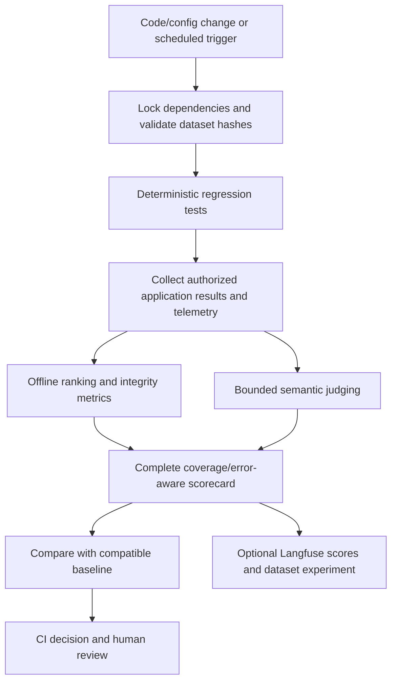

# Evaluation automation plan

Status: **design only**. This document does not add a scheduler, CI workflow, ranking evaluator, monitoring collector or new model run. Application and evaluation use the root `.venv`, `.env`, `pyproject.toml` and `uv.lock`; no Confident AI key is needed. Existing model/metric thresholds and raw scores remain unchanged.

“Answer correction” is interpreted below as **answer correctness**. A separate user-correction/feedback workflow is also included as proposed product work.

## 1. Current coverage versus requested metrics

| Area / metric | Considered or implemented now | Automation still needed |
|---|---|---|
| Faithfulness | DeepEval metric, threshold 0.8; requires actual claims and evidence. Empty answers are not applicability passes. | Independent/calibrated judge, per-claim audit and reproducible run comparison. |
| Answer correctness | G-Eval against curated reference/required facts, threshold 0.7. Lexical term checks remain separate diagnostics. | Atomic-fact completeness checks for amount, unit, role, independence, dates, exceptions and conflict/precedence conclusions. |
| Answer relevance | DeepEval Answer Relevancy, threshold 0.7. | Report relevance separately from correctness/completeness. |
| Context relevance | DeepEval Contextual Relevancy, threshold 0.7, on actual delivered context. | Evaluate both candidate retrieval and final context packing without mixing their results. |
| Context precision | DeepEval Contextual Precision, threshold 0.7. | Preserve ordered retrieval results; current synthesis ledger order is not raw retrieval rank. |
| Context recall | DeepEval Contextual Recall, threshold 0.7 where reference facts/context exist. | Separate document-grounded facts from application-control expectations in references; version any revised scoring policy. |
| MRR@k | **Not implemented or measured.** | Ordered results plus human-reviewed relevance labels; compute first-relevant-hit rank. |
| nDCG@k | **Not implemented or measured.** | Ordered results plus graded relevance labels and a declared gain/discount policy. |
| Retrieval latency | Local five-request API/search smoke measurements exist; retrieval stages are instrumented. | Per-attempt timing, stage breakdown, controlled p50/p95/p99 distributions and regression gates. |
| LLM latency | Generation observations have timing; calls are bounded. | Aggregate planner/synthesis/verification and retry timing per application run, by provider/model. |
| End-to-end latency | Workflow progress exists. DeepEval's per-case `seconds` is judge execution time, not application response time. | API receipt, queue entry, worker start and terminal timestamps; report queue wait, processing time and total duration separately. |
| Token usage | Provider usage is recorded when returned. | Aggregate every model call and failed/retried attempt; retain missing usage as unknown. |
| Cost/query | Assumption-based cost worksheet exists; no measured billed application cost/query. | Dated provider/model pricing, usage completeness and optional apportioned compute/embedding/reranking costs. Separate judge cost. |
| Retrieval failure | Encoder/database/tool errors can produce explicit failure outcomes. | Structured failure taxonomy and rates with stable denominators. |
| Empty retrieval | Search can return no items/no compatible sources; an expected no-eligible-source golden case exists. | Distinguish expected abstention, unexpected empty results, and execution failures. |
| Regression tests | Existing application tests and evaluator-safety tests cover substantial control flow and integrity. Latest verification: 24 passed/16 integration tests skipped; 12 evaluator tests passed. | CI stages, automatic model-quality comparisons, ranking labels, operational budgets and held-out evaluation. |

The restored LFM baseline ran only integrity, correctness and faithfulness. The retained GPT-SOL run attempted the broader seven-metric set. No ranking or system-performance result should be inferred for an unmeasured metric.

## 2. Evaluation data contract

Freeze and hash: source PDFs, golden cases, expected applicability, actor/permissions, reference date, processing profile, embedding model/revision, chunking configuration, application Git SHA, prompts/schema, generator and judge models, judge rubric version, runtime versions and budgets.

Add two distinct artifacts in the proposed collection stage:

- **Retrieval log:** question/subquery, actor/scope/date, iteration, tool, ordered dense/keyword/fused candidates, rank/distance/RRF score, canonical source/revision locators, and the final context order after expansion/deduplication. Do not sort by gold relevance or use final citations as relevance labels.
- **Operational log:** run/case/trace/observation IDs, request/queue/worker/terminal timestamps, per-retrieval and per-model attempt durations/status, token categories, price version, observed cost, missing-usage flags and stop reason.

Use frozen content hashes and source locators for relevance labels rather than installation-specific database UUIDs alone. Keep reference answers and relevance judgments outside generator/retriever inputs. The existing 55 source quotes seed positive labels but are not exhaustive ranked chunk judgments; unjudged candidates must not silently become irrelevant.

For offline reevaluation of saved outputs, explicitly label which outputs, evidence and telemetry were actually captured. Missing rank/timing/usage data is **not measured**; do not reconstruct it from evidence-ID order or invent application latency from judge timings.

## 3. Retrieval ranking evaluation

Create a reviewed qrels file per frozen query/scope. Grade candidates, for example: 0 irrelevant, 1 useful background, 2 supports part of the answer, 3 essential evidence/exception. Adjudicate ambiguous labels, annotate both sides of comparisons and review high-ranked previously unjudged candidates.

- `MRR@k = mean(1 / rank_of_first_relevant_result)`, with 0 when no relevant result occurs within k. Define the relevance cutoff and k before evaluating; proposed reporting depths are 5, 10 and 20.
- `DCG@k = sum((2^grade - 1) / log2(rank + 1))`; `nDCG@k = DCG@k / ideal_DCG@k` using the same gain policy. Cases with no eligible positive judgments have undefined ranking utility and are reported separately, not divided by zero.
- Report dense, lexical, fused and final packed context as different rankings. Section expansion can improve evidence coverage while introducing irrelevant passages; evaluate its tradeoff explicitly.
- Single-hit MRR does not establish a complete multi-hop answer. Add required-fact coverage, required-document-side coverage and exception/qualifier coverage alongside ranking metrics.
- Expected no-source, restricted-source and clarification cases get abstention/access/control checks. They do not receive artificial positive recall/MRR/nDCG scores.

MRR/nDCG acceptance thresholds must be calibrated on reviewed held-out relevance labels. There is no measured current baseline for them.

## 4. Operational definitions

| Measure | Proposed definition |
|---|---|
| Retrieval latency | Monotonic elapsed time per search attempt, with query encoding and SQL/fusion/expansion measured separately. |
| LLM latency | Per provider attempt, plus the sum across planning, synthesis and verification. Include failures/retries; optionally distinguish time-to-first-token where streaming actually exists. |
| End-to-end latency | Terminal result time minus API request receipt; queue wait and worker processing are separate components. A resumed clarification also reports user-wait time separately. |
| Token usage | Input, output, cached and reasoning tokens when actually reported. Avoid double-counting provider totals or treating unreported categories as zero. |
| Cost/query | Sum all application model attempts using dated model/provider prices, with cached-token rules where known. Show generation, embedding/reranking/compute attribution and judge costs separately. Unknown pricing/usage produces unknown cost, not $0. |
| Retrieval failure rate | Failed retrieval attempts / retrieval attempts, plus affected-query count. Categorize encoder, invalid-vector/profile, database, timeout, scope/access and tool-argument failures. |
| Empty retrieval rate | Successful eligible searches returning zero items / successful eligible searches. Also report query-level unexpected-empty count for answerable cases with authorized sources. |

No applicable ready revision is an expected outcome for some cases, not a database failure. Source-access denials must not leak whether inaccessible documents exist. A later insufficient answer is not proof that retrieval was empty: evidence may have been found but the model failed to use it.

Report distributions by scenario, model, document type, OCR/native input and corpus version. A five-request smoke p95 is simply the maximum sample and is unsuitable as a stable production SLA. Establish controlled sample sizes and hardware/provider conditions before latency gates.

## 5. Proposed automated workflow

**Every pull request:** dependency/config/schema checks, Ruff, mocked unit tests, offline golden validation and evaluator-safety tests. Use the root environment. No paid model calls or personal CLI credentials on untrusted/forked PRs. Integration tests run only against isolated test database/bucket resources, never the demonstration corpus.

**Opt-in smoke evaluation:** a small representative subset covering direct lookup, cross-page exception conditions, multi-hop/follow-up, comparison/conflict and missing/access-controlled information. Keep dependencies/parent questions inside the selected cap. Run deterministic scoring first, then only applicable semantic metrics.

**Scheduled or explicit full evaluation:** all 30 development cases plus a separately maintained unseen corpus. Pin configuration, collect raw outputs and ordered retrieval/operational logs, then evaluate them. Fresh end-to-end runs and re-judging saved answers are different experiments and must be labeled accordingly.

**Execution safety:** inherit the application's maximum five iterations and finite model-call budget. Apply provider-wide bounded concurrency/rate limits across workers—not just one semaphore per port. Configure per-request, per-case, per-run, token and cost budgets. A quota/usage-limit failure opens a circuit breaker and leaves remaining semantic metrics not run/inconclusive; do not keep sending calls. Retry only approved transient failures, at most once, preserving the original attempt. Never rerun a valid low score to select a better judgment.

**Collection:** write per-case records incrementally; retain interrupted-run status, errors, applicability and coverage. A final summary means the selected execution ended, not that all metrics succeeded. Preserve denominators and output baseline differences in JSON plus a readable Markdown scorecard. Validate source hashes before comparing runs.

**Dashboard:** optionally attach deterministic/semantic scores to actual Langfuse trace/observation IDs and link dataset experiment items. Use stable score IDs for idempotency, preserve reasons and label errors separately. Application run UUIDs are not Langfuse trace IDs. Raw references/evidence require an explicit data-capture/access policy; a metadata-only trace cannot itself support faithfulness judging.

## 6. Regression matrix and gates

| Group | Regression scenarios and required assertion |
|---|---|
| Ingestion and daily updates | Duplicate upload/idempotency, unsupported/corrupt input, OCR/table fixtures, failed batch recovery, processing-profile changes, source hashes, page offsets and new revision freshness. |
| Retrieval | Known fact recall, exact keyword/amount queries, correct historic/current version, wrong record class, both comparison sides, cross-page continuation, unexpected empty results, embedding dimension/profile rejection and stable ordered ranking artifacts. |
| Generation | Amount/currency/unit/boundary correctness, minimum versus maximum, exceptions, independent approver roles, supported unknowns, no fabricated precedence, complete required facts and exact source quotes. |
| Agent/controller | Five-iteration hard cap, model-call/deadline cap, no-progress exit, invalid IDs, missing-fact repair, checkpoint recovery without resetting budgets, clarification single-use resume and follow-up context. Some repair/coverage checks are desired behavior, not yet implemented features. |
| Security | Identity isolation, restricted-register non-disclosure, revoked-source saved answers, source reopening authorization and prompt-injection resistance. Metadata/logging must not reveal credentials or protected source text. |
| Review and correction | Existing conflict review version checks/audit. Planned answer correction: store original answer, correction and reviewer rationale separately; preserve history, add reviewed cases to a versioned dataset and rerun affected tests. General feedback intake is not implemented now. |
| Evaluator reliability | No empty-answer faithfulness pass; correct not-applicable logic; provider errors never treated as correct abstentions; low scores never selected by error-only retries; truncated/invalid judge output rejected; means retain error denominators; references and ranks not leaked to the generator. |
| Environment and observability | Root env loading, shared dependencies, no Confident AI key requirement, redaction, stable correlation IDs, token/cost null handling and missing-timestamp behavior. |

**Hard gates:** source/scope/access/citation violations fail. A budget violation or an unsupported substantive answer fails. Preserve existing semantic thresholds (0.7, faithfulness 0.8, integrity 1.0) unless a separately versioned, reviewed policy changes them. Require coverage for every applicable metric; provider failures make that quality check inconclusive, not a pass. Control-flow tests do not certify model accuracy.

**Baseline gates:** compare only compatible datasets, judges/rubrics and pipeline versions, with scenario breakdowns. Set allowed quality and p95/cost deltas after collecting a representative baseline and reviewed labels; do not invent an MRR/nDCG or production latency target from the current tiny sample. Model changes need a controlled experiment and human review of disagreements. Keep known benchmark defects such as mixed source/security reference expectations visible until corrected in a new rubric version.

## 7. Delivery order

1. **P0: reproducible collection and reporting.** Frozen manifests, scenario/applicability mapping, incremental artifacts, explicit failure taxonomy, judge calibration and deterministic CI. Preserve the two restored/retained 30-case baselines unchanged.
2. **P1: missing measurements.** Ordered candidate logs and reviewed qrels for MRR/nDCG; fact/document-side coverage; per-query latency/token/cost aggregation with explicit unknown values.
3. **P2: scheduled runs and review.** Provider-aware bounded execution, circuit breaking, compatible-baseline gates, held-out cases, Langfuse score/experiment linkage and correction review queues.

Acceptance: one opted-in run produces an auditable manifest, raw application outputs, ranked candidates, operational measurements, metric/applicability/error records, and a final readable scorecard without modifying gold labels or hiding failed attempts. Until these stages are implemented, the current suite remains manually invoked and the missing metrics remain not measured.
