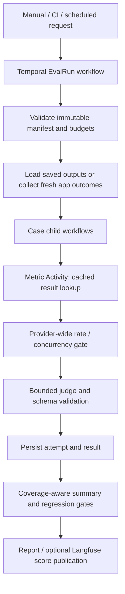

# Evaluation automation and durability roadmap

Updated 17 November 2026. This is the single execution guide and next-phase plan. [Latest results](evaluation-results.md) are the authoritative scorecard. The detached runner is implemented; **Temporal and the proposed LangGraph evaluator are design only**.

## Current runner: start, inspect, resume and stop

Application and evaluation share the root `.env`, `.venv`, dependencies and lockfile. No Confident AI key is needed.

```bash
uv run --frozen python -m evaluation.deepeval_suite.background status \
  --output evaluation/deepeval_suite/results/chunking-v2-durable-20261116-1

uv run --frozen python -m evaluation.deepeval_suite.background start \
  --output evaluation/deepeval_suite/results/chunking-v2-durable-20261116-1

uv run --frozen python -m evaluation.deepeval_suite.background stop \
  --output evaluation/deepeval_suite/results/chunking-v2-durable-20261116-1

# Fresh experiment: use a new directory, not the consolidated result.
uv run --frozen python -m evaluation.deepeval_suite.background start \
  --predictions evaluation/financial-v1/results-20261116-175816.jsonl \
  --output evaluation/deepeval_suite/results/my-new-experiment --max-cases 30
```

These commands are examples, not new runs started during consolidation. The canonical run has processed all cases but retains ten errors. Merged checkpoint counts include original and retry attempts: exhausted failures will not retry under the default two-attempt cap. Increase a cap explicitly only after addressing the cause; valid low scores are never retried to select a better score.

Implemented behavior:

- Detached workers survive terminal/chat disconnection; they do not auto-restart after reboot. Use `start` to resume.
- Atomic per-metric checkpoints and attempt history retain completed work. Successful metrics, including low scores, are reused. A crash may replay the in-flight metric.
- Input, label, judge/config and evaluator-code hashes protect compatible resume. `durable_batched_v2` uses bounded context batches and strict faithfulness scoring. Prompt changes require protocol versioning.
- An endpoint lock prevents duplicate local workers. Keep concurrency one for the current single-request gateway; extra ports do not multiply account quota.
- Quota/authentication/rate-limit errors pause; isolated deadline/transport errors are recorded, with a pause after three consecutive such failures. SDK retries are disabled; explicit resumes are capped per metric.
- `job.json`, `progress.json`, `run.log`, `requests.jsonl`, checkpoints and summaries expose identity, active metric, attempts, timings and returned token usage. Unknown usage/cost is not zero.
- Context batches retain IDs/order and statement-weighted scores, with no truncation. FIN-001 needed six calls instead of 27; larger evidence sets need additional batches.
- The current Codex bridge remains a CLI process per inference and checks token usage after generation. HTTP pooling does not remove upstream quotas or enforce an upstream output-token cap. Stopping a worker cannot guarantee provider-side cancellation or exactly-once billing.
- Langfuse tracing/datasets exist; automatic evaluator-score synchronization is not implemented. Final-context precision is not raw retrieval MRR/nDCG.

## Next phase: Temporal orchestration with existing metrics

**Recommendation:** migrate job lifecycle first while retaining the metric backend. Temporal supplies orchestration, not judge accuracy or extra provider quota. Avoid changing orchestration and scoring in the same experiment.



### 1. Freeze the experiment contract

Hash source PDFs, cases, reference date, actor/scope, processing/embedding/chunking profile, predictions, generator/judge configuration, prompts/schemas, metric protocol and thresholds. Distinguish re-judging saved outputs from fresh end-to-end collection. Fresh follow-ups depend on parent generation; saved follow-up scoring loads frozen parent context.

Use a result key such as `(run_id, case_id, metric_id, protocol, input_hash, judge_config_hash)`. Store large artifacts in MinIO and metadata/results in a separate evaluation schema or service. Do not silently expand the assignment's existing 12 application tables. Pass artifact references through workflow state, not complete PDFs, credentials or evidence payloads.

### 2. Define deterministic workflows and bounded Activities

The workflow schedules work, aggregates states, maintains budgets and waits for operator signals. Put model/API calls and storage I/O in Activities outside its deterministic replay path. One metric Activity gives a clear persistence/retry boundary; expensive context batches can have their own boundary. Case child workflows provide isolation.

Configure explicit request, Activity and run deadlines plus maximum attempts. Use heartbeats for long Activities and cooperative cancellation. Cache successful results before a call and persist each result before Activity completion using unique keys/upserts. A crash after an LLM response but before persistence can still duplicate a paid request; Temporal cannot guarantee external exactly-once billing. Use provider idempotency only where actually supported.

This follows Temporal's documented distinction between deterministic Workflows and failure-prone Activities. Retry policies must be bounded for model calls rather than relying on defaults. [Workflow definition](https://docs.temporal.io/workflow-definition), [retry policies](https://docs.temporal.io/encyclopedia/retry-policies).

### 3. Implement execution policy and scheduling

- Enforce provider/account limits globally across workers, not one semaphore per port. Start with concurrency one for the current gateway; raise it only against measured native inference capacity.
- Pause on quota/authentication; resume through an explicit operator signal after remediation. Treat transient network/timeout errors separately with capped backoff and recorded attempts. Never rerun a valid low score.
- Apply time, token and optional monetary budgets. Log input/output/cache/reasoning tokens only when reported; separate application and judge cost and retain unknown values.
- Run deterministic/schema/security tests on every PR. Model calls are opt-in; avoid personal credentials on untrusted CI. Use isolated test database/bucket resources.
- Schedule representative smoke cases first, then full/held-out evaluation. Configure schedule overlap policy so a slow run does not spawn duplicate billing.
- Optionally publish scores to actual Langfuse trace/observation IDs with stable score IDs. An application run UUID is not necessarily a Langfuse trace ID. Preserve access policy for references/evidence.

### 4. Acceptance and rollout

Kill workers during inference, after a metric finishes and during result persistence. Verify recovery, source-hash validation, no repeat of completed scores, attempt history, quota pause/resume, duplicate-launch prevention, capped cancellation and error-aware summaries. Test malformed JSON/IDs, deadlines, missing usage, storage failures and changed configs.

Then validate a small representative set with human review before scheduling all 30 cases plus unseen cases. No production accuracy or load claim follows from the five synthetic PDFs.

| Benefits | Drawbacks |
|---|---|
| Durable history, worker recovery, timers and explicit retry/cancellation policies. | Extra service/worker deployment, operational cost and replay/versioning discipline. |
| Central scheduling, operator-driven resume and workflow-level budgets. | Still needs provider-wide rate limits, idempotent persistence and carefully bounded attempts. |
| Scale execution without replacing current scoring. | Cannot fix judge output, increase account quota or eliminate ambiguous in-flight billing. |

Acceptance: an opted-in run survives worker death and produces one auditable, coverage-aware scorecard without repeating completed paid work except documented in-flight ambiguity. This is proposed work; no Temporal service or SDK has been added.

## Following phase: LangGraph-based evaluation instead of DeepEval

**Feasible, but LangGraph is an orchestrator, not a drop-in metric library.** We must implement, test and calibrate the judging definitions and score formulas ourselves. A node named “faithfulness” does not establish equivalence to a DeepEval metric.


Use PostgreSQL checkpointers with stable thread IDs and explicit task/node boundaries around external calls. Retain result idempotency keys and the same external-call crash caveat. A checkpointer needs a running worker to resume execution; it does not by itself create a production scheduler or account-wide limiter. [LangGraph persistence](https://docs.langchain.com/oss/python/langgraph/persistence), [graph API and retry boundaries](https://docs.langchain.com/oss/python/langgraph/graph-api).

Create a framework-neutral metric interface returning typed statements/verdicts, reason, deterministic score, threshold, applicability, protocol, usage and errors. Preserve source IDs/order, exact quotes, statement weighting and coverage validation. Permit at most one separately recorded schema repair, with a finite node/call budget; do not implement a “judge until pass” loop. Treat evaluated text as untrusted data.

Version a new protocol for changes in extraction, grouping, unsupported-claim treatment or thresholds. Compare LangGraph and DeepEval on frozen cases with the same judge configuration. Measure human agreement, disagreements, completion rate, calls, tokens and latency. Inspect material differences; do not merge scores from different protocols or demand numerical equality for changed methods.

| Option | Benefits | Drawbacks |
|---|---|---|
| Temporal + DeepEval | Mature metric ecosystem; lowest scoring migration risk; durable operational control. | Built-in multi-step costs and custom adapter maintenance remain. |
| LangGraph + custom metrics | Reuses project stack; transparent batching, validation, branching and review; persisted graph state. | We own metric definitions, calibration, reports, regression tests and failure semantics. |
| Temporal outside, LangGraph inside an Activity | Temporal manages schedules/worker recovery; LangGraph manages evaluation logic. | Two persistence systems; duplicate retries unless ownership is assigned explicitly. |

**Recommended order:** stabilize Temporal with current metrics, then pilot LangGraph as a separate backend. Keep Temporal as outer scheduler if it still adds operational value. Adopt a custom evaluator only after measured benefits justify maintaining its scoring suite.

## Measurement backlog and gates

- Retrieval: capture raw ranked candidates and final packed context separately. Add reviewed relevance labels for MRR@k/nDCG@k and required-fact/document-side coverage for multi-hop. Ranking metrics are not measured now.
- Generation: correctness, strict faithfulness, relevance, amounts/units/dates/roles/conditions, exact citations and honest abstention. General answer-correction intake remains proposed.
- Operations: encoding/SQL/retrieval/LLM/queue/end-to-end timing distributions, reported tokens, priced cost with explicit unknowns, retrieval failures, expected versus unexpected empty retrieval. Judge timing is not app response time.
- Regression/security: identity isolation, restricted sources, revoked permissions, prompt injection, daily revision freshness, maximum five app exploration iterations, no-progress exits and immutable history.
- Gates: fail scope/access/citation violations; execution errors make the affected quality gate inconclusive. Always show scored/error/not-applicable denominators. Compare compatible manifests/protocols and calibrate latency/ranking/cost limits on representative data.

No framework removes upstream latency/quotas or the need for independent labels and human calibration.
